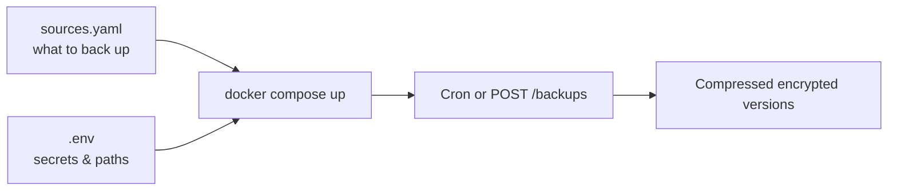
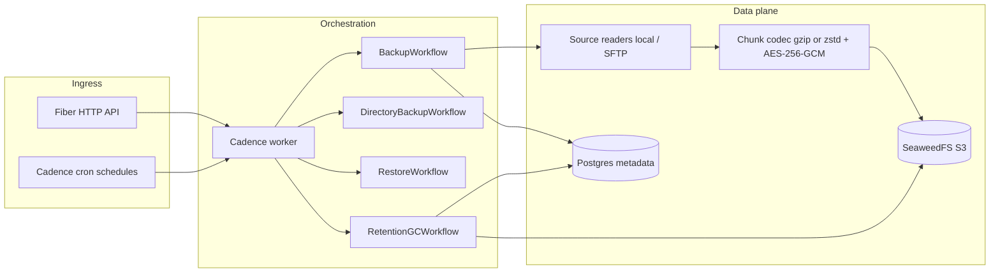

<h1 align="center">
  
</h1>

Self-hosted backup & disaster recovery: **versioned**, **deduplicated**, **compressed** (gzip/zstd), **encrypted** (AES-256-GCM) file protection across **local paths**, **SFTP**, and **database dumps**—immutable object storage, Cadence observability.

---

## Get protected in three steps



| Step | You do | CosmosBDR handles |
|------|--------|-------------------|
| **1. Declare sources** | In `sources.yaml`: each source `id`, `type` (`local` or `sftp`), paths under `container_mount` or `remote_root`, optional `schedules` and `pre_backup` | Validates config at startup; resolves `env:` / `*_ref` from `.env` |
| **2. Wire secrets** | In `.env`: SSH private key, host key fingerprint, `ENCRYPTION_KEY`, bind-mount paths for Postgres/Seaweed/source data | Registry load, Cadence domain, Seaweed bucket, encryption at chunk layer |
| **3. Run** | `docker compose up -d --build` — then enable schedules or call the API | Chunking, dedup, gzip/zstd + AES-256-GCM, durable Cadence workflows, retention GC, list/restore APIs |

Optional **database DR**: run dumps on the remote (customer cron) or define a `pre_backup` command in YAML—Cosmos still only backs up the resulting **file**. Full walkthrough: [Configuration](docs/configuration.md), remote SSH: [SFTP runbook](docs/sftp-sources-runbook.md).

---

## Restore after corruption or loss

CosmosBDR keeps **version history** per logical path (`backup_key` = `source_id:relative_path`). If a file is corrupted, ransomware-touched, accidentally deleted on the source, or a VM is rebuilt, you already have what you need: the same `sources.yaml` / `.env`, a running stack, and intact **Postgres + Seaweed** data (on this host or a DR copy of those volumes).

| Step | Action |
|------|--------|
| **1. Find a good snapshot** | `GET /api/v1/backups?backup_key=<source_id>:<relative_path>` — newest-first list with timestamps and `checksum` |
| **2. Restore** | `POST /api/v1/restores` with `source_id`, `relative_path`, and `target_path` — omit `source_job_item_id` for **latest** eligible, or pin an older `job_item_id` before the incident |
| **3. Confirm** | Optional: `shasum -a 256` on the restored file vs API `checksum` ([restore guide](docs/restore.md#verify-restored-dump-checksum)) |

Writes land on **local** paths under `/host-data` or back on the **remote** over SFTP (same SSH config as backup). **Directory trees** use one restore call with `payload.directory`; **database DR** restores the dump file—then you run `pg_restore` / `mysql` on the DB host ([Restore](docs/restore.md), [DB dump recovery](docs/restore.md#database-dump-recovery)).

No new agents on production machines; restore is the same HTTP + Cadence workflow you can watch at `http://localhost:8088`.

```bash
# Latest version of a file back to a local path (container sees /host-data)
curl -s -X POST http://localhost:8080/api/v1/restores \
  -H 'Content-Type: application/json' \
  -d '{
    "flow_type": "RESTORE",
    "target_path": "/host-data/e2e_test_asset_v2.restored",
    "payload": {
      "source_id": "local-host-data",
      "relative_path": "e2e_test_asset_v2.dat"
    }
  }' | jq .
```

---

## Why CosmosBDR exists

Traditional backup tools often fall into one of two camps: **opaque appliances** you cannot audit, or **ad-hoc rsync/cron scripts** that do not give you versioning, deduplication, encryption, or provable retention.

CosmosBDR targets teams that need:

| Need | How CosmosBDR addresses it |
|------|----------------------------|
| **Multi-origin data** | One control plane for laptop folders, Windows SFTP shares, and Linux VMs |
| **Version history** | Every backup is a snapshot you can list and pin for restore |
| **Efficiency** | Content-hashed 4 MB chunks with skip-on-unchanged files |
| **Defense in depth** | AES-256-GCM + compression at rest; optional Seaweed S3 **COMPLIANCE** object lock |
| **Operational clarity** | Cadence workflows you can trace in the UI; schedules declared in Git-friendly YAML |
| **Database DR without vendor lock-in** | Back up **dump files** (Postgres, MySQL, anything that writes to disk)—not a proprietary agent |

CosmosBDR is **not** a managed-cloud PITR replacement (RDS, Cloud SQL). It excels when **you own the VMs and paths** and want logical exports and file trees off-site with policy you control.

---

## Features

- **Single-file backup** from `local` (`HOST_DATA_PATH` → `/host-data`) or `sftp` (`remote_root` + `relative_path`)
- **Directory backup** with `all` or `matched` selection, **glob** and **regex** include/exclude, depth and size filters
- **Declarative schedules** — Cadence cron per row in `sources.yaml` (`enabled: true` registers on startup)
- **`pre_backup` hooks** (SFTP only) — SSH exec once per job for `pg_dump`, `mysqldump`, unzip, tar extract, custom scripts (defined entirely in YAML)
- **`dump_freshness`** — fail the job if a dump artifact is older than `max_age_hours` (avoids silent SKIP on stale dumps)
- **Restore** — single file or directory tree to local mount or remote SFTP; pin version via `source_job_item_id` or `backup_key`
- **Retention GC** — nightly Cadence cron expires snapshots past per-source `ttl_days` and reclaims unreferenced chunks (respects WORM)
- **HTTP API** — trigger backup/restore, list versions, reconcile schedules ([API reference](docs/api-reference.md))

---

## Architecture (how it works)



**Single-file backup path**

1. **Init job** in Postgres (flow, paths, `backup_key`).
2. Optional **`RunPreBackupActivity`** — one remote SSH exec when `pre_backup` is configured on the source.
3. **`InspectFile`** — size → mtime → full-file SHA-256; matching prior snapshot → **SKIP** (clone chunk refs, no re-upload). See [skip rules](docs/backup-workflow.md#skip-vs-complete-unchanged-files).
4. **`ProcessFileChunk`** — 4 MB segments, dedupe by plaintext hash, encrypt/compress, put to Seaweed.
5. **`PublishSnapshotManifest`** — version metadata for list/restore APIs.
6. Optional **remote cleanup** of staging file when `output.cleanup_after: true`.

**Directory jobs** run `ListDirectory` first, then fan out child `BackupWorkflow` instances per selected file (with Cadence concurrency limits from `.env`).

**Restore** resolves the target version (latest eligible or pinned ID), reads chunks from Seaweed, decrypts, and writes to `target_path` (local or SFTP).

See [Backup workflow](docs/backup-workflow.md), [Restore](docs/restore.md), [API reference](docs/api-reference.md), and [Architecture reference](docs/architecture.md) for diagrams and UI screenshots.

---

## Technology stack

| Component | Role | Why this choice |
|-----------|------|-----------------|
| **Go** | API, workers, chunk pipeline | Single static binary, strong concurrency, fits SFTP `ReadAt` chunk I/O |
| **Fiber** | HTTP API | Fast, low ceremony for a small control-plane surface |
| **Uber Cadence** | Durable workflows + cron | Retries, visibility, schedule overlap policy; long backup jobs need orchestration, not fire-and-forget goroutines |
| **PostgreSQL** | Jobs, items, chunk index | Relational queries for version lists, retention, and dedup metadata |
| **SeaweedFS (S3 API)** | Blob store | S3-compatible, self-hosted, supports **Object Lock** for WORM compliance mode |
| **Atlas** | SQL migrations | Applied via `docker-compose` before the app starts |
| **AWS SDK v2 (S3)** | Seaweed client | Mature multipart + object-lock headers |
| **`pkg/sftp`** | Remote sources | Stat, mtime, ranged reads—required for chunked backup without full-file staging |
| **`chunkcodec`** | gzip/zstd + AES-256-GCM | Dedup on plaintext hash; encrypt after dedup decision |

---

## Quick start (Docker Compose)

Hands-on version of [Get protected in three steps](#get-protected-in-three-steps). Same outcome: configured sources, healthy stack, first backup.

### Prerequisites

- Docker Desktop (or Docker Engine) with Compose
- Absolute host paths for Postgres, Seaweed, and backup source data
- For **SFTP sources**: SSH access to the remote (`user`, key, pinned `host_key_fingerprint` in YAML + `.env`)

### 1. Configure environment

```bash
cp .env.example .env
```

Edit `.env`:

- `HOST_DATA_PATH` — folder on the host mounted at `/host-data` in the app container
- `SEAWEED_DATA_PATH`, `POSTGRES_DATA_PATH` — persistent data directories (**do not nest** under `HOST_DATA_PATH`)
- `ENCRYPTION_KEY` — 32-byte hex (or 32-char dev string)
- `SEAWEED_ACCESS_KEY` / `SEAWEED_SECRET_KEY` — S3 credentials for Seaweed
- Per-source `SOURCE_ID_*` variables (see [Configuration](docs/configuration.md))

Review and adjust `sources.yaml` (committed template with local + example SFTP sources). For a new remote: duplicate an `sftp` block, set `id`, `host`, `user`, `remote_root`, and `ssh.secret_ref` / `host_key_fingerprint` refs—then add the matching variables to `.env`. Set `enabled: true` on schedules only when you intend to run crons.

Field-by-field reference: **[Configuration guide](docs/configuration.md)** · **[SFTP sources runbook](docs/sftp-sources-runbook.md)**.

### 2. Start the stack

```bash
docker compose up -d --build
docker compose ps   # all services Up; postgres + seaweedfs (healthy)
```

Expected output: [Configuration — first-time setup](docs/configuration.md#first-time-setup).

Services:

| Service | Port | Purpose |
|---------|------|---------|
| `cosmosbdr` | `8080` | HTTP API + Cadence worker |
| `cadence-web` | `8088` | Workflow UI |
| `seaweedfs` | `8333` (S3), `8888` (filer) | Object storage |
| `postgres` | `5432` | Metadata (+ Cadence DBs) |

### 3. Verify health

```bash
curl -s http://localhost:8080/health | jq .
curl -s http://localhost:8080/api/v1/sources | jq .
```

### 4. Trigger a backup (local file)

Place a test file under `HOST_DATA_PATH`, then:

```bash
curl -s -X POST http://localhost:8080/api/v1/backups \
  -H 'Content-Type: application/json' \
  -d '{
    "flow_type": "BACKUP",
    "payload": {
      "source_id": "local-host-data",
      "relative_path": "e2e_test_asset_v2.dat"
    }
  }' | jq .
```

Watch execution in **Cadence Web** at `http://localhost:8088` (domain `samples-domain`).

More examples: import [`docs/bruno-api-collection/CosmosBDR.zip`](docs/bruno-api-collection/CosmosBDR.zip) into [Bruno](https://www.usebruno.com/) (see [collection README](docs/bruno-api-collection/README.md)) or read [API reference](docs/api-reference.md).

### 5. List backup versions

```bash
curl -s 'http://localhost:8080/api/v1/backups?backup_key=local-host-data:e2e_test_asset_v2.dat' | jq .
```

Hands-on restore: [Restore after corruption or loss](#restore-after-corruption-or-loss).

---

## Documentation

| Guide | Description |
|-------|-------------|
| **[Configuration](docs/configuration.md)** | Every `sources.yaml` field and `.env` variable |
| **[Backup workflow](docs/backup-workflow.md)** | Single/directory jobs, schedules, globs/regex, `pre_backup`, DB dumps |
| **[Restore](docs/restore.md)** | Version pinning, directory restore, DB dump recovery |
| **[Garbage collection](docs/garbage-collection.md)** | TTL, retention cron, orphaned chunks, WORM interaction |
| **[API reference](docs/api-reference.md)** | Endpoints, payloads, example responses |
| **[WORM / Object Lock runbook](docs/worm-runbook.md)** | S3 COMPLIANCE mode, testing, filer hygiene |
| **[SFTP sources runbook](docs/sftp-sources-runbook.md)** | Windows/Linux SSH, Docker networking |
| **[Architecture reference](docs/architecture.md)** | Design principles, capability map, storage layout |
| **[Bruno collection](docs/bruno-api-collection/README.md)** | [`CosmosBDR.zip`](docs/bruno-api-collection/CosmosBDR.zip) — import into Bruno |

### Advanced topics (not summarized above)

- **WORM / Object Lock** — compliance testing and delete behavior: [worm-runbook.md](docs/worm-runbook.md)
- **Skip-on-unchanged backups** — `unchanged: true` in version lists: [backup workflow](docs/backup-workflow.md#skip-vs-complete-unchanged-files)
- **Seaweed S3 access** — unsigned `GET` on the bucket endpoint returns **403**; use signed SDK paths: [API reference](docs/api-reference.md#seaweedfs-not-a-public-http-get)

---

## Development

```bash
# Run unit tests
go test ./...

# WORM integration test (Seaweed on :8333)
export SEAWEED_INTEGRATION=1
go test -tags=integration -run TestWORM ./src/storage/
```

---

## License

See [LICENSE](LICENSE).