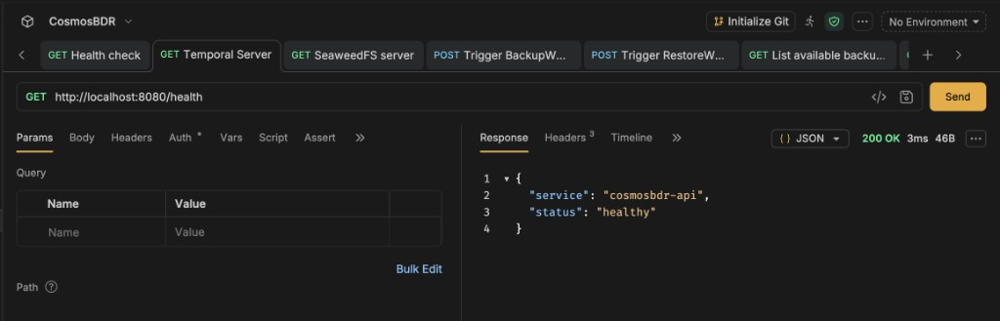
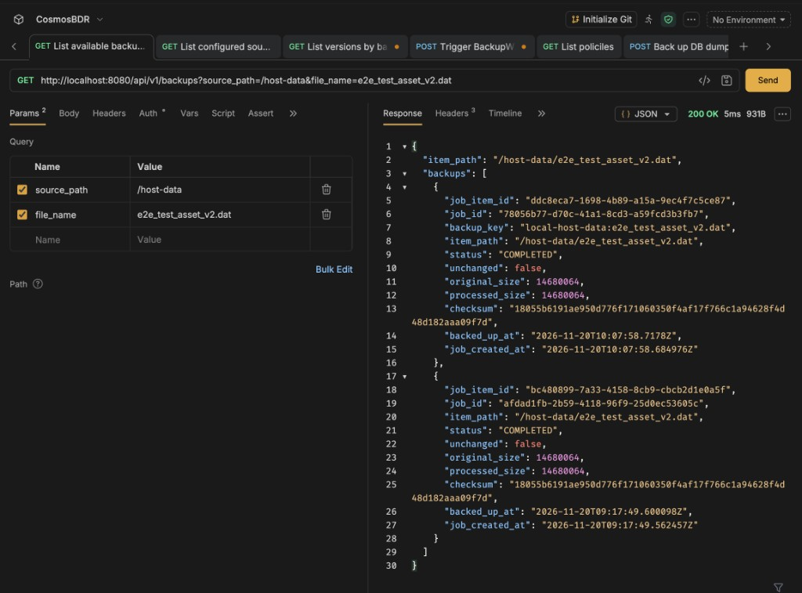
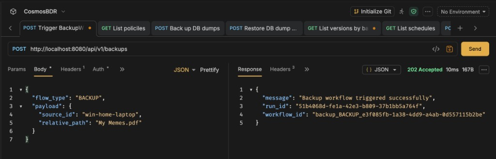
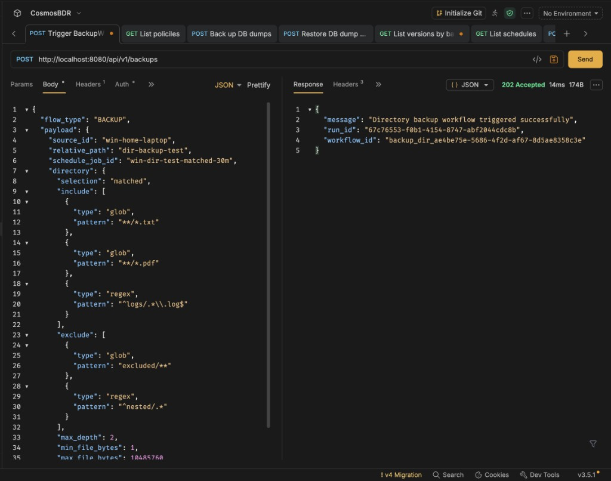
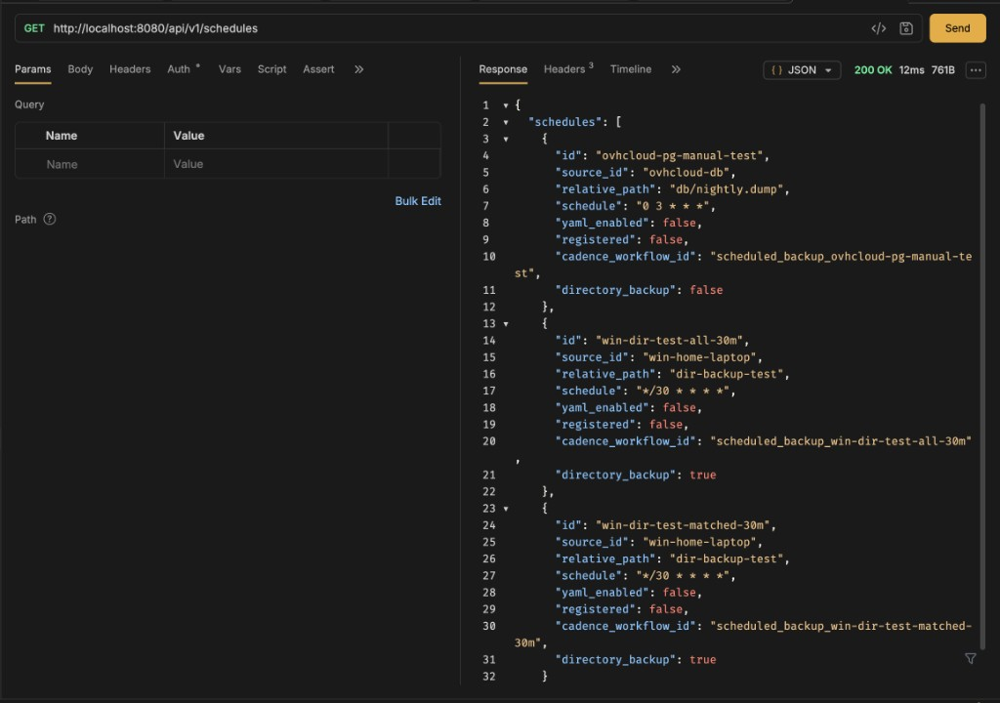
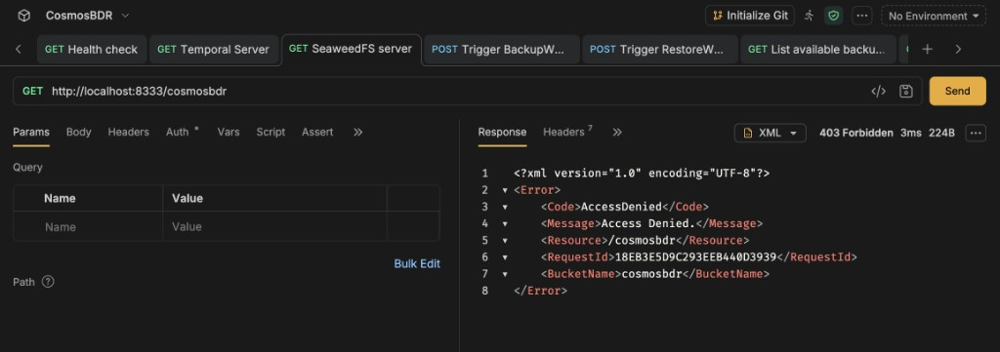

# HTTP API reference

Base URL (default): `http://localhost:8080`

Interactive collection: import [`bruno-api-collection/CosmosBDR.zip`](bruno-api-collection/CosmosBDR.zip) into Bruno ([instructions](bruno-api-collection/README.md)). Request shapes below mirror that collection.

---

## Health

```http
GET /health
```

**Response** `200`:

```json
{
  "status": "healthy",
  "service": "cosmosbdr-api"
}
```



---

## Status

```http
GET /api/v1/status
```

**Response** `200`:

```json
{
  "message": "CosmosBDR control plane active"
}
```

---

## Sources

```http
GET /api/v1/sources
```

Lists configured sources **without secrets**.

**Response** `200` — array of summaries:

```json
[
  {
    "id": "local-host-data",
    "type": "local",
    "container_mount": "/host-data",
    "ttl_days": 90
  },
  {
    "id": "win-home-laptop",
    "type": "sftp",
    "host": "192.168.x.x",
    "ttl_days": 90
  }
]
```

---

## Backups

### List backup versions

```http
GET /api/v1/backups?backup_key=<source_id>:<relative_path>
GET /api/v1/backups?item_path=<full logical path>
GET /api/v1/backups?source_path=/host-data&file_name=<name>   # legacy
```

**Example** — `GET /backups` in the Bruno collection:

```http
GET /api/v1/backups?backup_key=prod-db-vm:db/nightly.dump
```

**Response** `200`:

```json
{
  "backup_key": "prod-db-vm:db/nightly.dump",
  "item_path": "",
  "backups": [
    {
      "job_item_id": "uuid",
      "job_id": "uuid",
      "backup_key": "prod-db-vm:db/nightly.dump",
      "item_path": "/remote/path/...",
      "status": "COMPLETED",
      "unchanged": false,
      "original_size": 1048576,
      "processed_size": 220000,
      "checksum": "sha256hex…",
      "backed_up_at": "2026-11-24T08:57:00Z",
      "job_created_at": "2026-11-24T08:57:01Z"
    },
    {
      "job_item_id": "uuid",
      "job_id": "uuid",
      "backup_key": "prod-db-vm:db/nightly.dump",
      "item_path": "/remote/path/...",
      "status": "SKIPPED",
      "unchanged": true,
      "original_size": 1048576,
      "processed_size": 220000,
      "checksum": "sha256hex…",
      "backed_up_at": "2026-11-25T02:00:00Z",
      "job_created_at": "2026-11-25T02:00:05Z"
    }
  ]
}
```

`unchanged: true` means `InspectFile` treated the file as identical to the prior snapshot (size, mtime, full-file SHA-256) and cloned chunk references without re-upload. Details: [Backup workflow — skip vs complete](backup-workflow.md#skip-vs-complete-unchanged-files).



### Trigger backup

```http
POST /api/v1/backups
Content-Type: application/json
```

**Body** — `flow_type` must be `"BACKUP"`.

Single file (modern):

```json
{
  "flow_type": "BACKUP",
  "payload": {
    "source_id": "local-host-data",
    "relative_path": "e2e_test_asset_v2.dat"
  }
}
```

Directory — add `directory` to `payload` (see [backup-workflow.md](backup-workflow.md)).

**Response** `202`:

```json
{
  "message": "Backup workflow triggered successfully",
  "workflow_id": "backup_BACKUP_…",
  "run_id": "…"
}
```

Directory jobs return `"message": "Directory backup workflow triggered successfully"`.





**Errors** `400` — validation (`unknown source_id`, missing paths); `500` — Cadence start failure.

---

## Restores

```http
POST /api/v1/restores
Content-Type: application/json
```

**Body** — `flow_type` `"RESTORE"` (default if omitted on some clients).

```json
{
  "flow_type": "RESTORE",
  "target_path": "/host-data/nightly.verify.dump",
  "payload": {
    "source_id": "prod-db-vm",
    "relative_path": "db/nightly.dump"
  }
}
```

Optional: `source_job_item_id`, `source_directory_job_id`, `directory` scope for tree restore.

**Response** `202`:

```json
{
  "message": "Restore workflow triggered successfully",
  "workflow_id": "restore_RESTORE_…",
  "run_id": "…"
}
```

---

## Schedules

| Method | Path |
|--------|------|
| `GET` | `/api/v1/schedules` |
| `POST` | `/api/v1/schedules/reconcile` |
| `POST` | `/api/v1/schedules/:id/register` |
| `POST` | `/api/v1/schedules/:id/deregister` |

`:id` is `schedules[].id` from `sources.yaml` (e.g. `prod-db-pg-nightly`).

Bruno (`CosmosBDR.zip`): **Register schedule crons**, **De-register schedule crons**, **Reconcile schedule crons with sources.yaml**.

After editing YAML, **restart** the app to reload registry; use **reconcile** to align Cadence with enabled flags without full redeploy when supported.



Examples: `POST /api/v1/schedules/prod-db-pg-nightly/register` and `.../deregister` (schedule `id` from `sources.yaml`).

---

## SeaweedFS (not a public HTTP GET)

An unauthenticated `GET http://localhost:8333/cosmosbdr` returns **403 AccessDenied** — the S3 API requires signed requests (the CosmosBDR app uses `SEAWEED_ACCESS_KEY` / `SEAWEED_SECRET_KEY`). Use the filer UI (`:8888`), backup/restore workflows, or AWS CLI with credentials to verify blobs.



---

## Workflow observability

All async operations return `workflow_id` and `run_id`. Open **Cadence Web** (`CADENCE_UI_PORT`, default `8088`) → domain `samples-domain` → search by workflow id.

---

## Error shape

Most errors:

```json
{
  "error": "human-readable message"
}
```

---

## Related

- [Backup workflow](backup-workflow.md)
- [Restore](restore.md)
- [Configuration](configuration.md)