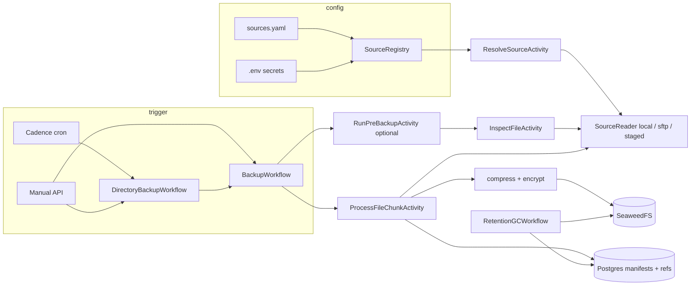
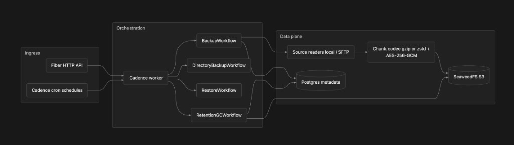

# Architecture reference

How CosmosBDR is put together: configuration model, identity, ingestion, retention, and storage layout. For day-to-day operation, start with [configuration](configuration.md), [backup workflow](backup-workflow.md), and [API reference](api-reference.md).

---

## Platform overview

- **Ingress:** HTTP triggers → Cadence `BackupWorkflow` / `DirectoryBackupWorkflow` / `RestoreWorkflow` / `DirectoryRestoreWorkflow` (restore is manual). Optional `pre_backup` SSH hook runs **once per job** (single-file or directory parent).
- **Source data:** Host folder bind-mounted as `/host-data` via `HOST_DATA_PATH` in `docker-compose.yml` (backup *source*, not Seaweed).
- **Pipeline:** Single file per job → `InspectFile` (size/mtime/hash, SKIP + chunk clone) → fixed 4 MB chunks → content-hash dedup → SeaweedFS (S3 API) → Postgres job/item/chunk metadata + snapshot manifest.
- **Versions:** List/restore by logical path; optional `source_job_item_id` pins a version (default latest eligible).
- **Encrypt/compress:** `chunkcodec` — plaintext SHA-256 dedup, then gzip/zstd + AES-256-GCM per chunk; legacy plaintext Seaweed objects still restore (`encrypted=false`, `compression_alg=none`).

---

## Strategic goal

Treat every backup target as a **logical item** with a stable identity, backed by a **pluggable source reader**. The chunk → encrypt/compress → Seaweed → Postgres manifest path stays the same; only ingestion, orchestration (directory, schedule, retention), and restore targets evolve.

---

## 1. Configuration model (YAML + `.env`)

### Files (suggested layout next to `.env`)

| File | Check in? | Contents |
|------|-----------|----------|
| `sources.yaml` | Yes | Source definitions, SSH connection params (refs only), **per-source retention TTL**, **per-source backup schedules (Cadence cron)** |
| `.env` | No | SSH keys/passphrases, key paths, `ENCRYPTION_KEY`, etc. |

**Single file for backup config:** connection, retention, and scheduled jobs all live under each source in `sources.yaml`—no separate `backup-jobs.json` or `backup-policies.yaml`.

### Secret resolution

- In YAML: **references only**, e.g. `ssh_secret_ref: PROD_WEB01_SSH_PRIVATE_KEY` (PEM in env) or path via env.
- Startup: load YAML → validate schema → resolve refs from env → **SourceRegistry** (immutable after load).
- **Known hosts:** prefer pinned `host_key_fingerprint` in YAML (commit-safe) over disabling host key verification.

### Validation & loading (`src/config/`)

- **Schema + structs:** JSON Schema (or equivalent) definitions, YAML → Go struct mapping, and `SourceRegistry` loader live under `src/config/` (alongside existing env config).
- **Fail fast:** if `sources.yaml` fails validation, required fields are missing, or mandatory secrets from `.env` cannot be resolved, the **server must not start** (log explicit errors and exit non-zero).
- **CI:** run the same validation in tests so invalid YAML does not merge.

### Example source record

```yaml
version: 1
sources:
  - id: local-host-data
    type: local
    container_mount: /host-data

  - id: prod-app-01
    type: sftp
    host: prod-app-01.example.com
    port: 22
    user: cosmosbdr-backup
    domain: production
    remote_root: /var/lib/myapp/data
    ssh:
      secret_ref: PROD_APP01_SSH_KEY
      known_hosts_policy: pinned
      host_key_fingerprint: "SHA256:..."
      proxy_jump: bastion.example.com
    # Retention TTL is configured per source (see §6, §15)
    retention:
      ttl_days: 90
    # Cadence cron schedules — one row per target; stable `id` becomes workflow id suffix
    schedules:
      - id: prod-config-nightly
        relative_path: config/app.yml
        schedule: "0 2 * * *"
        enabled: true
      - id: prod-data-weekly
        relative_path: data
        schedule: "0 3 * * 0"
        directory:
          selection: all
          exclude:
            - type: glob
              pattern: "**/*.tmp"
```

Each schedule row is `relative_path` **+** `schedule` under its source. **Single-file:** omit `directory`. **Directory tree:** set `directory` (same shape as `POST /backups`). Schedule `id` values must be **unique across the whole file** (not just within one source). `enabled: false` skips Cadence registration but still validates at load.

Manual HTTP triggers still use `source_id` **+** `relative_path` (or legacy `source_path` + `file_name`). No `policy_id` layer.

---

## 2. Source types & DB dumps

### Remote files: SFTP (not SCP as primary)

| Concern | SFTP | SCP |
|---------|------|-----|
| Stat / mtime / size | Yes | Awkward |
| Parallel `ReadAt(offset, len)` for 4 MB chunks | Yes | Whole-file copy |
| Fits `InspectFile` + `ProcessFileChunk` | Yes | Poor |

**SCP fallback (optional):** download entire file to temp, then run existing local pipeline—OK for small files / MVP only.

**Remote file flow:**

1. Open SSH/SFTP session (pool or per-workflow with retries).
2. Stat remote path → same decision ladder as today.
3. `ReadAt` per chunk activity instead of `os.Seek`/`Read`.

### Database dumps

CosmosBDR protects **files** in Seaweed (chunked, encrypted). Database DR is: **produce a dump file → back it up like any other file**. Restore **writes the dump file back to disk** (local or SFTP). Import into PostgreSQL/MySQL (`psql`, `pg_restore`) remains operator-driven.

Most engines ship **dump tools**, not **scheduled dumps**. Production teams use **cron**, SQL Server Agent, Ansible, or **cloud snapshot/PITR** (RDS, Cloud SQL). Cosmos fits **self-managed VMs** and **logical exports to a path**; it does **not** replace managed-cloud control-plane backups.

#### Tier 1 — **Default (customer-owned dump schedule)**

| Who           | What                                                                                                                                                                                |
| ------------- | ----------------------------------------------------------------------------------------------------------------------------------------------------------------------------------- |
| **Customer**  | Scheduled dump on the DB host (`pg_dump`, `mysqldump`, custom script, SQL Agent) → stable path under `remote_root` (e.g. `backups/postgres/latest.dump`, often a `latest` symlink). |
| **CosmosBDR** | `type: sftp` + schedule or API on `relative_path` → `InspectFile` → chunks → Seaweed.                                                                                               |

**Operational rule:** run dump **before** Cosmos schedule (e.g. dump 01:00, backup 02:00). Cosmos does not run customer dump tooling in Tier 1—it only SFTP-backs up the artifact at `relative_path`.

**Risk — stale file + SKIP:** if tonight’s dump fails and the file is unchanged, `InspectFile` may **SKIP** on mtime/hash. Mitigation: optional **`dump_freshness`** — inspect fails when mtime is too old ([backup workflow — skip](backup-workflow.md#skip-vs-complete-unchanged-files)).

```yaml
dump_freshness:
  max_age_hours: 26
  relative_paths:
    - cosmosbdr/nightly.dump
```

#### Tier 2 — **Optional `pre_backup` **on** `sftp` **sources**

Optional **source-level remote hook**: one SSH exec on the backup host **before** the backup job runs (single-file or directory parent). Typical use: DB export (host or Docker), staging refresh, unzip, quiesce script—**all** defined in YAML via `pre_backup.command` + `env_refs` (no code-level engine presets).

```yaml
sources:
  - id: prod-db-vm
    type: sftp
    host: db.internal
    remote_root: /var/backups
    ssh: { secret_ref: ..., host_key_fingerprint: "SHA256:..." }
    pre_backup:
      command:
        - /opt/cosmosbdr/pg-dump.sh
      env_refs:
        PGPASSWORD: PROD_PG_PASSWORD
        REMOTE_ROOT: PROD_VM_REMOTE_ROOT
      output:
        relative_path: cosmosbdr/nightly.dump   # under remote_root; single-file backup target when set
        cleanup_after: true                     # optional remote delete after successful upload
    schedules:
      - id: pg-nightly
        relative_path: cosmosbdr/nightly.dump
        schedule: "0 2 * * *"
        enabled: true
```

| Mechanism                             | Role                                                                                                                                          |
| ------------------------------------- | --------------------------------------------------------------------------------------------------------------------------------------------- |
| `pre_backup.command` **+** `env_refs` | Only mechanism: SSH exec (argv from YAML only—never from HTTP API). Docker, postgres, mysql, unzip, etc. are all user-defined in `command`. |
| **Output path**                       | Hook output under `remote_root` + path; `output.relative_path` overrides single-file backup target; directory jobs use schedule/API `relative_path` for the hook unless overridden. |

**Workflow:**

```text
BackupWorkflow (single file)
  → Init → [optional] RunPreBackupActivity once (SSH exec)
  → InspectFile → chunk fan-out → manifest → finalize
  → [optional] cleanup remote staging file (output.cleanup_after)

DirectoryBackupWorkflow
  → Init → [optional] RunPreBackupActivity once (not per child)
  → ListDirectory → child BackupWorkflow per file
  → [optional] cleanup when parent succeeds
```

**Staging:** remote file on the SSH host, then **SFTP ranged reads**.

**Security:** commands and secret refs come **only** from `sources.yaml`; DB creds resolve from `.env` like SSH keys.

#### When to use which tier

| Situation | Use |
|-----------|-----|
| Dump already exists on a schedule | **Tier 1** — `sftp` only |
| Separate team owns DB; Cosmos only off-sites files | **Tier 1** |
| Single Cadence schedule; backup must fail if dump fails | **Tier 2** — `pre_backup` |
| Non-standard engine (Oracle RMAN, etc.) | **Tier 2** — `pre_backup.command` or customer script in **Tier 1** |
| RDS / Cloud SQL as primary DR | Vendor snapshot/PITR; Cosmos for **exports** or files on a bastion |

#### One remote host → multiple `source_id`s

`source_id` **is a policy boundary**, not “one physical machine.” Register **two (or more) sources** for the same SSH host when you mix **DB dump jobs** with **ordinary file backups**.

| Why not one source?                  | Detail                                                                                                                                |
| ------------------------------------ | ------------------------------------------------------------------------------------------------------------------------------------- |
| `pre_backup` **is source-wide (v1)** | If `pre_backup` is set, **every** backup job on that `source_id` runs the hook once first (single-file or directory parent)—not scoped to one schedule path yet. |
| **Different lifecycle**              | DB dumps vs config/data often need different `ttl_days`, schedules, and failure handling.                                             |
| `backup_key`                         | `backup_key = source_id:relative_path`—split IDs keep version history and restore pins unambiguous.                                   |

| Source `id` (example) | `pre_backup` | Typical schedules |
|-----------------------|--------------|-------------------|
| `prod-vm-files` | *(omit)* | `config/app.yml`, `data/…`, Tier 1 path to customer cron dump |
| `prod-vm-db` | `command` + `env_refs` | **Only** the dump artifact path (e.g. `cosmosbdr/nightly.dump`) |

**Reuse connection settings** with YAML anchors (one host block, two sources):

```yaml
version: 1

x-prod-vm-sftp: &prod_vm_sftp
  type: sftp
  host: env:PROD_VM_HOST
  port: 22
  user: env:PROD_VM_USER
  remote_root: env:PROD_VM_REMOTE_ROOT
  ssh:
    secret_ref: PROD_VM_SSH_KEY
    known_hosts_policy: pinned
    host_key_fingerprint: env:PROD_VM_HOST_KEY_FINGERPRINT

sources:
  - id: prod-vm-files
    <<: *prod_vm_sftp
    retention:
      ttl_days: 365
    schedules:
      - id: prod-vm-config-nightly
        relative_path: config/app.yml
        schedule: "0 1 * * *"
        enabled: true

  - id: prod-vm-db
    <<: *prod_vm_sftp
    retention:
      ttl_days: 90
    pre_backup:
      command:
        - /opt/cosmosbdr/pg-dump.sh
      env_refs:
        PGPASSWORD: PROD_PG_PASSWORD
      output:
        relative_path: cosmosbdr/nightly.dump
        cleanup_after: true
    schedules:
      - id: prod-vm-pg-nightly
        relative_path: cosmosbdr/nightly.dump
        schedule: "0 2 * * *"
        enabled: true
```

`.env`**:** one set of `PROD_VM_`* (and DB `*_REF`) vars can back both sources; Cadence schedule ids must stay **globally unique** across the file.

**Defer** path-scoped `pre_backup` (hook only for certain paths) until product need is clear—**two `source_id`s** remains the supported pattern when DB hooks must not run for ordinary file jobs.

---

## 3. Stable identity: `backup_key`

Do not key version history only on container-local paths.

```text
backup_key = "{source_id}:{normalized_relative_path}"
# e.g. prod-app-01:config/app.yml
```

Persist: `source_id`, `source_type`, logical path, optional display URI.

List/restore APIs accept `backup_key` or `(source_id, relative_path)`.

---

## 4. Source Reader abstraction

```text
SourceReader:
  Stat(ctx) → size, mtime, isDir
  ContentSHA256(ctx) → when tier-3 hash needed
  ReadAt(ctx, offset, length) → []byte
  List(ctx, prefix) → []Entry   # directories
```

| Implementation | Role |
|----------------|------|
| `LocalReader` | Current `os` under `/host-data` |
| `SFTPReader` | Remote ranged reads |
| `StagedFileReader` | Not implemented; remote backups use `SFTPReader` |

### Activities (conceptual)

| Activity | Role |
|----------|------|
| `ResolveSourceActivity` | Request/policy → reader + paths |
| `InspectFileActivity` | Reader instead of `os` |
| `ProcessFileChunkActivity` | `ReadAt` |
| `ListDirectoryActivity` | Directory policies |
| `RunPreBackupActivity` | Optional SSH exec once per backup job (`pre_backup` on `sftp`) |
| `RestoreTargetActivity` (later) | Local or SFTP write |

Remote workloads: longer activity timeouts, tuned parallel chunk count.

---

## 5. Workflows

### Single file

Graph: Init → **[optional] RunPreBackup** once → Inspect → chunk fan-out → manifest → finalize.

### Directory backup

`DirectoryBackupWorkflow` **(parent):**

0. **[optional] RunPreBackupActivity** once when the source has `pre_backup` (before list; children do not repeat it).
1. `ListDirectoryActivity`: walk under `relative_path`, apply **selection** rules below.
2. Child `BackupWorkflow` per matched file; `CADENCE_MAX_CONCURRENT_WORKFLOWS` for child batches. All activities share `CADENCE_WORKER_MAX_CONCURRENT_ACTIVITIES` (worker pool + per-wave schedule in chunk workflows).
3. Parent tracks totals/failures; **best-effort** (continue other files if a child fails).

**Failure handling:** Activities use a default retry policy (5 attempts, exponential backoff). After permanent activity/workflow failure: `FailJobExecutionActivity` marks `PENDING` job items `FAILED`, then job `FAILED` + `error_message`. Partial Seaweed chunk blobs from aborted runs are **not** deleted here — **retention GC** reclaims unreferenced chunks later.

Schema: optional `parent_job_id`, optional schedule job `id` on job payload for traceability. Parent job **payload stores the resolved directory filter** (selection, patterns, limits) for audit / DR drills.

**Trigger (conceptual):** `source_id` + directory `relative_path` + optional `directory` block. Single-file jobs unchanged (`relative_path` + `file_name` or path to one file).

#### Selection modes

Two explicit modes; default `all` (DR-friendly: tree as-is under the root).

| Mode      | Meaning                                                                                                                                                      |
| --------- | ------------------------------------------------------------------------------------------------------------------------------------------------------------ |
| `all`     | Every **file** under `relative_path` is a candidate, then **exclude** patterns (and size limits) apply. `include` **is ignored** (must be empty or omitted). |
| `matched` | `include` **required** (≥1 pattern). A file must match **at least one** include (glob or regex), then **exclude** removes matches.                           |

#### Patterns: glob and regex

Each include/exclude entry is a small object (not a bare string):

```json
{ "type": "glob", "pattern": "**/*.yml" }
{ "type": "regex", "pattern": "\\.(sql\\.gz|dump)$" }
```

- **Glob:** `path/filepath`-style matching on the file path **relative to the directory root** (`relative_path`), `/` separators, case-sensitive (document if we add fold-case later).
- **Regex:** Go `regexp` syntax; match against the same **relative path** string (not basename-only unless the pattern says so).
- Invalid regex → **fail the list activity** (parent job fails fast); do not silently skip.

#### Precedence (no contradiction solver)

Fixed order; predictable, same as common backup tools:

1. Walk files under `relative_path` (directories traversed, never backed up as items).
2. Apply `max_depth` if set (omit or `null` = **unlimited** — default for DR).
3. Apply `selection` **mode** (`all` vs `matched` + include).
4. Apply `exclude` (glob or regex); **exclude wins** if both include and exclude match.
5. Optional `min_file_bytes` / `max_file_bytes`.

#### Example (`matched` + glob and regex)

```json
{
  "flow_type": "backup",
  "source_id": "prod-app-01",
  "relative_path": "data",
  "directory": {
    "selection": "matched",
    "include": [
      { "type": "glob", "pattern": "**/*.json" },
      { "type": "regex", "pattern": "^config/.*\\.ya?ml$" }
    ],
    "exclude": [
      { "type": "glob", "pattern": "**/staging/**" },
      { "type": "regex", "pattern": "\\.swp$" }
    ],
    "max_depth": null,
    "max_file_bytes": null
  }
}
```

#### Example (full tree for DR, junk excluded)

```json
{
  "flow_type": "backup",
  "source_id": "local-host-data",
  "relative_path": ".",
  "directory": {
    "selection": "all",
    "exclude": [
      { "type": "glob", "pattern": "**/.cache/**" },
      { "type": "glob", "pattern": "**/*.tmp" }
    ]
  }
}
```

### Schedules vs restore

- **Backup schedules:** each `sources.yaml` `schedules[]` row with `enabled: true` (default when omitted) → Cadence cron (`workflow_id` = `scheduled_backup_<id>`). Each tick runs `BackupWorkflow` or `DirectoryBackupWorkflow` with the same resolved request as `POST /backups`. Job payload includes `schedule_job_id` when cron-fired.
- `enabled` **in YAML:** **declared default** for deploy and `POST /schedules/reconcile` — not the knob for day-to-day pause. Leave schedule definitions and cron expressions in git-reviewed YAML; use `enabled: false` for “off by default” on new environments. **Pause/resume at runtime:** `POST /schedules/{id}/deregister` and `POST /schedules/{id}/register` (no stack restart). **Note:** restart or reconcile re-applies YAML `enabled` (API pause is overridden if YAML still says `enabled: true`).
- **Startup:** reconcile enabled/disabled rows and cron drift (register / terminate) after the worker starts.
- **Schedule API:** `GET /schedules`, `POST /schedules/{id}/register`, `POST /schedules/{id}/deregister`, `POST /schedules/reconcile` (see runbook).
- **Restore:** manual HTTP only (no cron). Single-file: `POST /restores` → `RestoreWorkflow`. Directory: same endpoint → `DirectoryRestoreWorkflow` (fan-out child restores; targets from Postgres backup metadata, not live disk listing).

---

## 6. Retention TTL & chunk GC

Two lifecycles:

1. **Versions:** `job_items` + manifests (including SKIPPED) in Postgres.
2. **Blobs:** Seaweed chunk objects on the **CosmosBDR host** (bind-mounted `SEAWEED_DATA_PATH`; see [§13](#13-seaweedfs-storage--host-bind-mounts))..

**TTL:**

- `ttl_days` **is set on each entry in** `sources.yaml` (source-level default for all `backup_key`s under that source). **Omitted** `retention` **or** `ttl_days: 0` **disables expiry GC for that source** (orphan chunk sweep still runs globally).
- When a backup version’s age **exceeds the source TTL**, expire that version’s **metadata** (job_items, manifests, item_chunk links for that version only).

**Physical delete:**

- After TTL (and `retain_until` when object lock is on), eligible data is **removed for real** via `RetentionGCActivity`.
- **Chunk objects** in Seaweed are deleted only when **no remaining** `item_chunk` **row references them** (global refcount). Shared chunks from dedup must survive while any **in-TTL or newer** version still points at them.
- Order: expire version metadata → remove that version’s chunk links → **GC pass** deletes unreferenced chunks from Seaweed and orphan `chunks` rows if applicable.

**SKIPPED** versions count toward history and TTL like any other completed snapshot.

`RetentionGCWorkflow`**:** daily Cadence cron, separate from backup; applies per-source TTL from config loaded at startup.

### Changing `ttl_days` after backups exist

`ttl_days` is **not** copied onto each snapshot. Retention GC uses the **current** value (from `SourceRegistry` at startup). Uploads that use object lock also persist **`retain_until = snapshot_time + ttl_days`** on chunk/manifest metadata and on Seaweed (COMPLIANCE). Edit `sources.yaml` and **restart** the app for a new TTL to take effect.

| Case | One-line summary |
|------|------------------|
| **Restart** | New `ttl_days` applies only after the app/worker restarts and reloads the registry. |
| **Shorten TTL** | GC may target snapshots sooner, but WORM still blocks blob/manifest purge until each object’s original `retain_until`. |
| **Lengthen TTL** | GC keeps Postgres metadata longer, but existing Seaweed locks stay at snapshot + **old** TTL unless a new backup **dedup-extends** the chunk. |
| **TTL → 0** | Per-source expiry GC stops for that source; old `retain_until` on chunks/manifests still governs deletes until they lapse; global orphan-chunk sweep still runs. |
| **New backups only** | Each run uses **current** `ttl_days` for lock duration; a config change alone does **not** rewrite `retain_until` on past snapshots. |

Without object lock, only the GC side applies (no stored `retain_until` gate on blobs); shortening or lengthening TTL changes what gets expired on the next GC run after restart.

### WORM / object immutability

**Ops runbook:** [worm-runbook.md](./worm-runbook.md) (enable, filer/S3 delete smoke test, integration tests, volume migration).

**When disabled (`SEAWEED_OBJECT_LOCK_ENABLED=false`):** TTL + refcount GC only. Anyone with Seaweed delete access can remove blobs before policy TTL.

**When enabled:** use a bucket created with **object lock + versioning**. Uploads use S3 **COMPLIANCE** `retain_until = snapshot_time + source.ttl_days`; deduped chunks get retention extended via `PutObjectRetention`. `RetentionGCActivity` uses versioned `DeleteObject`; lock deny → skip (`blobs_skipped_object_lock`).

**WORM** adds a **storage-layer** rule: chunk/manifest objects cannot be deleted or overwritten until `retain_until`, even with app or S3 credentials (COMPLIANCE).

| Layer | Lock off | Lock on |
|-------|----------|---------|
| **When data may go away** | Postgres age > `ttl_days` → GC | Same app TTL + `now >= retain_until` on blobs |
| **Who can delete early** | Anyone with Seaweed delete access | Denied until `retain_until` |
| **Dedup** | Refcount while snapshots in TTL | Per-chunk **max(`retain_until`)** via `ExtendObjectRetention` |

**Alignment with TTL:** at upload, `retain_until = snapshot_time + source.ttl_days`. GC deletes only when metadata is expired **and** `now >= retain_until` (and refcount allows for chunks).

**Verify immutability:** use S3 **`DeleteObject` with `versionId`** or `go test -tags=integration -run TestWORM` — **not** the filer UI trash (filer bypasses lock; see [worm-runbook.md](./worm-runbook.md)).

**Not built in:** separate writer vs GC S3 credentials (single app identity today). **3-2-1 off-host copy** still required for serious DR; WORM is not a second site.

---

## 7. Encrypt & compress

**Order:**

```text
plaintext segment → SHA-256 (dedup key)
                 → compress (gzip/zstd)
                 → encrypt (AES-256-GCM, per-object nonce)
                 → Seaweed upload
```

- Dedup on **plaintext hash** (app-level); skip upload when hash exists.
- Store: `compression_alg`, encrypted flag, `compressed_size_bytes`.
- Restore: download → decrypt → decompress → write; verify hash.

Shared `chunkcodec` for backup and restore.

---

## 8. Docker & SSH

- Keys: env PEM or read-only secret mount—never in image.
- Pinned host key fingerprint in YAML.
- App must reach `host:22` (or `proxy_jump`).
- SFTP connection/channel limits → lower parallelism for remote policies.
- **Local source:** `HOST_DATA_PATH` → `/host-data`.

---

## 9. API evolution (minimal)

**Backup store vs restore target:**

- **All backup bytes** live in **SeaweedFS** on the machine running CosmosBDR, with chunk data on a **host bind-mounted path** (`SEAWEED_DATA_PATH`). Remote SFTP/SSH paths are **sources only**—never the durability tier.
- **Restore (default):** read chunks from Seaweed → decrypt/decompress → write back to the **same path as the backup source** (local `container_mount` or SFTP `remote_root` + relative path). Existing files are overwritten (create if missing; parent dirs created on write). Optional `target_path` on the API restores to a local path on the CosmosBDR host instead (e.g. DR staging under `/host-data`).

**Directory restore (implemented):**

- **List targets:** `ListDirectoryRestoreActivity` reads eligible backup snapshots (never walks the remote tree).
- **Pin a directory backup run:** `payload.source_directory_job_id` = parent job id from `DirectoryBackupWorkflow` → restores each child file with that run’s `source_job_item_id`.
- **Latest under a folder:** `source_id` + directory `relative_path` and optional `directory` selection block → latest eligible snapshot per `backup_key` under that prefix; optional glob/regex filter applies to **backed-up keys**, not live files.
- **Orchestration:** parent `DirectoryRestoreWorkflow` → concurrent child `RestoreWorkflow` per file (same chunk decrypt/decompress/write path as single-file restore).

**Endpoints (conceptual):**

- **Backup:** `{ "source_id", "relative_path" }` in payload (see runbook for shape); directory jobs add `directory` scope.
- **List:** by `backup_key` or `source_id` + path.
- **Restore (file):** `source_id` + `relative_path` (file path), optional `source_job_item_id`, optional top-level `target_path`.
- **Restore (directory):** `source_id` + directory `relative_path`, optional `source_directory_job_id`, optional `directory` filter; see [sftp-sources-runbook.md](./sftp-sources-runbook.md).

---


## 10. Capability map

| Capability | User-facing docs |
|------------|------------------|
| `sources.yaml` + `backup_key` | [configuration.md](configuration.md) |
| Local + SFTP ingestion | [backup-workflow.md](backup-workflow.md), [sftp-sources-runbook.md](sftp-sources-runbook.md) |
| Directory backup/restore | [backup-workflow.md](backup-workflow.md), [restore.md](restore.md) |
| Schedules + schedule API | [api-reference.md](api-reference.md) |
| Retention GC | [garbage-collection.md](garbage-collection.md) |
| Encrypt/compress at chunk layer | [backup-workflow.md](backup-workflow.md#encryption-deduplication-worm) |
| DB dumps + `dump_freshness` | §2, [backup-workflow.md](backup-workflow.md#database-dumps-postgres-mysql-and-more) |
| WORM | [worm-runbook.md](worm-runbook.md) |

---

## 11. Design principles

1. `backup_key = source_id:relative_path`
2. SFTP primary; local mount for co-located sources
3. Database DR: Tier 1 (cron dump + SFTP) or Tier 2 (`pre_backup` on a dedicated source)
4. Backup via cron or API; restore via API only
5. Plaintext-hash dedup; encrypted blobs in Seaweed
6. Durability on the CosmosBDR host (`SEAWEED_DATA_PATH` + Postgres)
7. Restore writes back to the original source path unless `target_path` is set
8. Per-source `ttl_days`; optional WORM
9. Bad `sources.yaml` or missing secrets → process exits
10. Directory `all` / `matched` with glob and regex filters
11. Schedules in YAML plus runtime `/schedules` register/deregister
12. DB restore = dump file on disk; engine import is manual
13. Separate `source_id` when mixing file backups and `pre_backup` on one host

---

## 12. Architecture diagram



Static overview (same ingress / orchestration / data-plane view as the README):



---

## 13. SeaweedFS storage & host bind mounts

### Recommended layout (`docker-compose.yml`)

| Mount | Purpose |
|-------|---------|
| `${HOST_DATA_PATH}:/host-data` | **Backup source** data (files you protect)—explicit host path |
| `${SEAWEED_DATA_PATH}:/data` | **SeaweedFS** chunk store (`.env`) |
| `${POSTGRES_DATA_PATH}:/var/lib/postgresql/data` | Metadata |

Prefer bind mounts over named volumes for anything you need to keep.

### Docker Desktop (Mac): limits & crash recovery

| | **Named volume** (`seaweeddata`, `pgdata`) | **Bind mount** (host path) |
|---|--------------------------------------------|----------------------------|
| **Where data lives** | Inside the Linux VM **virtual disk** | On the Mac filesystem (path you choose) |
| **Effective size cap** | Docker **Settings → Resources → Virtual disk limit**, shared with images, other volumes, build cache | Mac disk free space |
| **Docker stop / restart** | Usually persists | Persists |
| **VM corrupt, factory reset, “delete all data”** | **High risk of loss** unless exported | Folder **survives** on the host |
| **Backup / inspect** | Opaque (`docker volume` tooling) | Finder, Time Machine, `rsync`, normal paths |

The concern is usually **not** a per-volume quota, but **all chunk data competing for space inside one capped VM disk**—backups grow, the VM disk fills, and every service suffers.

### Should SeaweedFS be bind-mounted to the local host?

**Dev / laptop (this project):** **Prefer bind mounts** for Seaweed (and consider the same for Postgres metadata) so chunk/job data is not trapped inside the Docker VM. Named volumes are acceptable for throwaway experiments only.

**Production / DR seriousness:** **Prefer explicit durable storage**, not an anonymous named volume on a single laptop:

| Approach | When |
|----------|------|
| **Bind mount** e.g. `./data/seaweed:/data` or `/var/lib/cosmosbdr/seaweed:/data` | Single-node prod, clear backup-of-backup, rsync snapshots |
| **Dedicated disk/volume** (EBS, PVC in K8s, managed NFS) | Prod default |
| **Remote object store** (Seaweed alongside or migration to S3-compatible external bucket) | Multi-AZ, avoid single Docker host as SOLE copy of chunks |

**Important separation:**

- `HOST_DATA_PATH` = sources being backed up (may be remote via SFTP later; mount is for *local* sources).
- **Seaweed volume** = immutable chunk store (the DR artifact). Losing the host source without Seaweed loses nothing; losing Seaweed loses all backups.

### Recommendations

1. **Do not** bind-mount Seaweed to the same tree as `HOST_DATA_PATH` (avoid backing up the backup store accidentally without policy).
2. **Do** document a host path or cloud volume for Seaweed in prod; add bind mount or PVC when you leave pure local dev.
3. **Do** plan 3-2-1: Postgres metadata + Seaweed blobs replicated or snapshotted off the app host.
4. Encrypt/compress at chunk layer complements—not replaces—storage redundancy.

### Target compose pattern (bind mount)

```yaml
# seaweedfs service — SEAWEED_DATA_PATH must be set in .env (no compose default)
volumes:
  - ${SEAWEED_DATA_PATH}:/data

# postgres service — POSTGRES_DATA_PATH must be set in .env
volumes:
  - ${POSTGRES_DATA_PATH}:/var/lib/postgresql/data
```

---


### Migrating from named volumes

- **Fresh start:** remove old volumes, empty host dirs, re-run backups.
- **Keep history:** copy data before cutover so Postgres and Seaweed stay aligned.
- **Object lock:** see [worm-runbook.md](worm-runbook.md).

### Off-host copies

Plan a second copy of `SEAWEED_DATA_PATH` and `POSTGRES_DATA_PATH` for production DR.

---

## 14. Product decisions (summary)

| Topic | Decision | Implication |
|-------|----------|-------------|
| **Where backups live** | Seaweed on the CosmosBDR host | Remotes are ingest only |
| **Restore default** | Original path from `backup_key` | Optional local `target_path` |
| **WORM vs TTL** | Per-source TTL + optional COMPLIANCE lock | [worm-runbook.md](worm-runbook.md) |
| **YAML validation** | Fail-fast loader | No degraded startup |
| **Database backups** | Tier 1 or Tier 2 `pre_backup` | Restore returns the dump file |
