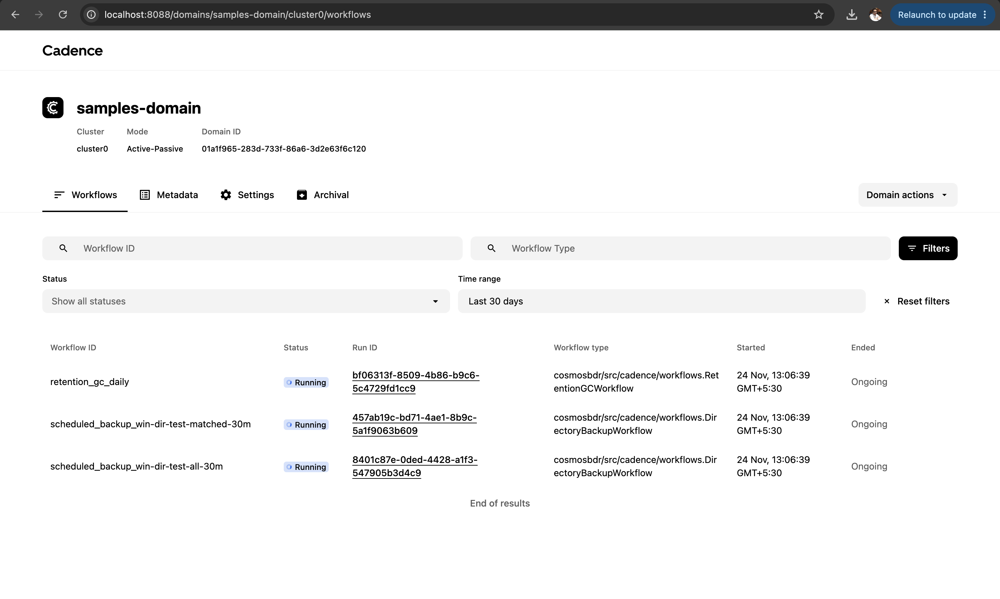
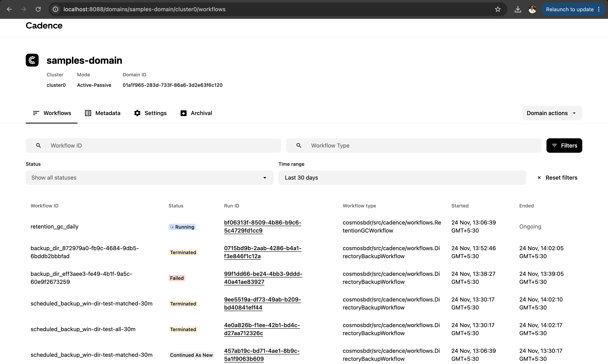
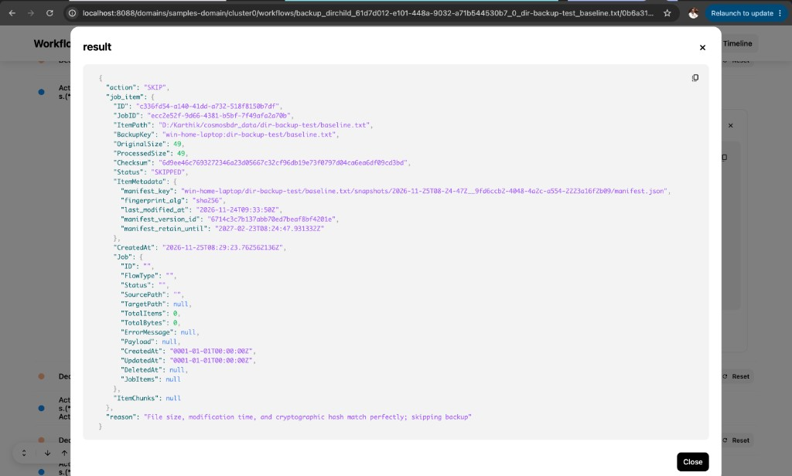
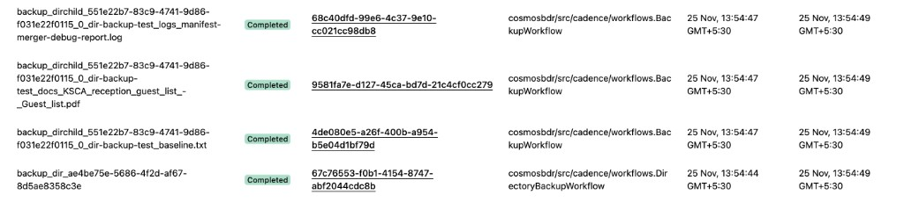
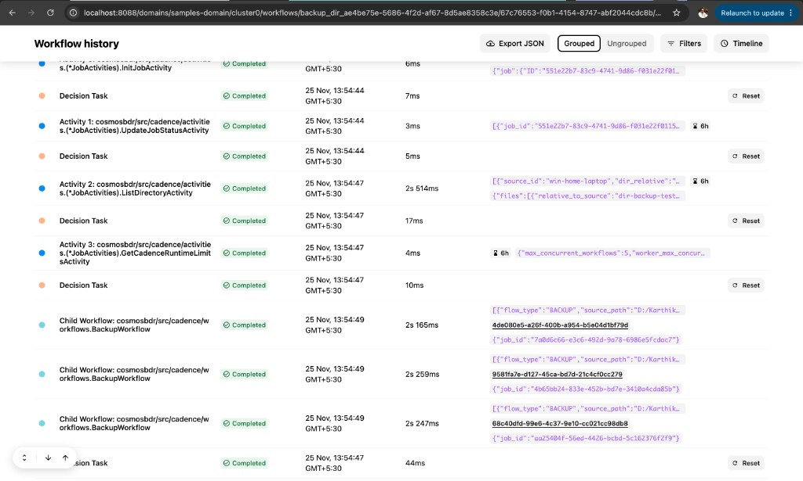
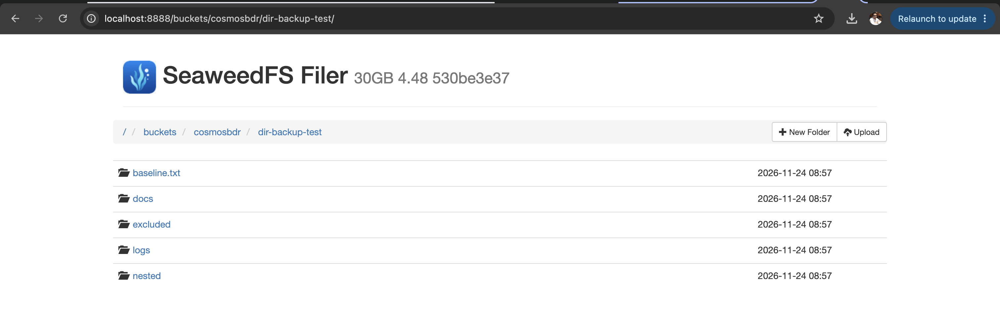
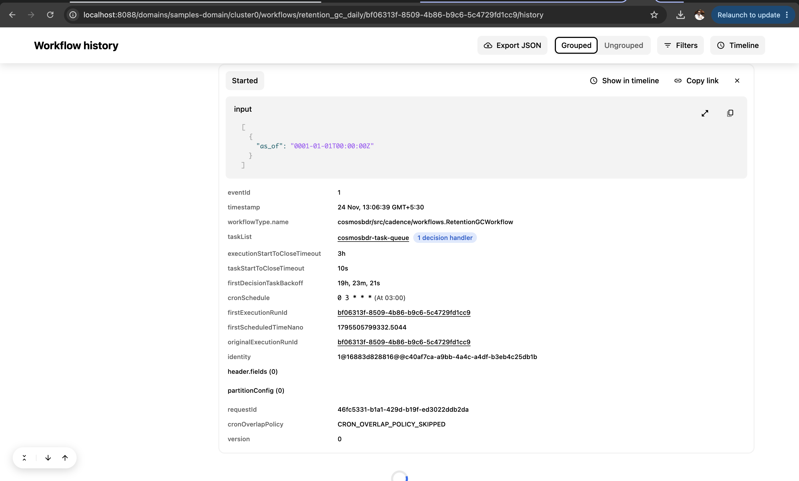

# Backup workflow

Backups are **durable Cadence workflows** triggered by the HTTP API or by **cron schedules** defined in `sources.yaml`.

---

## Modes

| Mode | Workflow | When |
|------|----------|------|
| **Single file** | `BackupWorkflow` | `payload.directory` omitted; one `relative_path` |
| **Directory** | `DirectoryBackupWorkflow` | `payload.directory` set (API or schedule) |

Cadence workflow ids:

- Manual single: `backup_BACKUP_<uuid>`
- Manual directory: `backup_dir_<uuid>`
- Scheduled: `scheduled_backup_<schedule_id>`

Monitor runs at `http://localhost:8088` (domain `samples-domain`).





---

## Identity: `source_id`, paths, and `backup_key`

Preferred API shape:

```json
{
  "flow_type": "BACKUP",
  "payload": {
    "source_id": "local-host-data",
    "relative_path": "reports/q4.pdf"
  }
}
```

| Concept | Rule |
|---------|------|
| **`source_id`** | Must exist in `sources.yaml` |
| **`relative_path`** | Path under `container_mount` (local) or `remote_root` (SFTP) |
| **`backup_key`** | Server-computed: `source_id:relative_path` (stable version key) |
| **Legacy** | `source_path` + `file_name` still supported for local-only jobs |

When the source has **`pre_backup.output.relative_path`**, single-file backups target that artifact path after the hook runs (API `relative_path` may still select schedule identity).

---

## Single-file pipeline

```text
InitJob
  → [optional] RunPreBackupActivity   (SSH exec, source-level)
  → InspectFile                       (hash / skip decision)
  → ProcessFileChunk × N              (4 MB, dedupe, encrypt, Seaweed)
  → CompleteJobItem
  → PublishSnapshotManifest
  → FinalizeJob
  → [optional] CleanupPreBackupActivity
```

### Skip vs complete (unchanged files)

Every single-file backup runs **`InspectFileActivity`** after `InitJob` (and optional `pre_backup`). That activity decides whether to **re-chunk and re-upload** or **skip** because the file is unchanged since the last successful snapshot for the same logical key.

| `job_items.status` | Meaning |
|--------------------|---------|
| **COMPLETED** | File changed (or first backup): `ProcessFileChunk` ran; new or deduped chunk blobs in Seaweed; new manifest. |
| **SKIPPED** | File unchanged vs latest snapshot: **no** `ProcessFileChunk`; historical `item_chunks` rows are **cloned** onto the new `job_item`; manifest still published; job ends **SUCCESS**. |

**Baseline for comparison:** newest prior row for the same **`backup_key`** (`source_id:relative_path`) among jobs with `status = SUCCESS` and `job_items.status` in **`COMPLETED` or `SKIPPED`** (skipped runs count as version history and restore targets).

**Decision ladder** (`InspectFileActivity`):

```text
0. [optional] dump_freshness — if this path is listed and mtime is older than max_age_hours → FAIL (no skip)
1. No prior snapshot for backup_key → PROCEED (full backup)
2. Prior exists:
     size ≠ historical OR mtime (UTC, second precision) ≠ historical → PROCEED
     else → stream file, compute full-file SHA-256
           hash ≠ historical checksum → PROCEED (same size/mtime but bytes changed)
           hash = historical checksum → SKIP (clone chunk map from prior item)
```

On **SKIP**, the workflow **does not** run `ProcessFileChunk` or `CompleteJobItem` hashing upload paths; it publishes a snapshot manifest, runs `FinalizeSkippedBackupItemActivity` (`backup_outcome: "unchanged"` in item metadata), and finalizes the job.

**Directory backups:** each matched file gets its own child `BackupWorkflow`; inspect/skip is **per file** (one file may `COMPLETED` while another `SKIPPED` in the same parent job).

**API / operators:** `GET /api/v1/backups?backup_key=…` lists versions newest-first. Skipped runs appear with `"status": "SKIPPED"` and `"unchanged": true` (see [API reference](api-reference.md#list-backup-versions)).



**Stale database dumps:** if tonight’s `pg_dump` never ran, the dump file can still match last night’s size/mtime/hash → **silent SKIP**. Use source-level **`dump_freshness`** so inspect **fails** when mtime is too old instead of skipping (see [configuration — `dump_freshness`](configuration.md#dump_freshness-optional)).

> **Chunk-level dedup** (reuse an existing global chunk hash during `ProcessFileChunk`) is separate from **file-level SKIP** above. SKIP avoids reading/chunking the file at all when the whole file matches the last snapshot.

---

## Directory backup

Set `directory` on the API payload or on a `schedules[]` row.

### Selection modes

| `selection` | Behavior |
|-------------|----------|
| `all` | Every file under `relative_path` unless excluded |
| `matched` | Only paths matching **include** rules (and not excluded) |

### Filters (`include` / `exclude`)

Each rule:

```yaml
- type: glob    # or regex
  pattern: "**/*.txt"
```

| Filter | Description |
|--------|-------------|
| `max_depth` | Max directory depth below `relative_path` (`2` = root + two levels) |
| `min_file_bytes` / `max_file_bytes` | Size bounds |

Patterns match paths **relative to the directory root** (e.g. `logs/app.log`, not the full `remote_root`).

Example from [`sources.yaml`](../sources.yaml):

- **all** job — exclude `**/*.tmp`, `**/~$*`, regex `^scratch/.*`
- **matched** job — include `**/*.txt`, `**/*.pdf`, regex `^logs/.*\.log$`; exclude `excluded/**` and `^nested/.*`; `max_depth: 2`

Example layout on a Windows SFTP source (`remote_root` → `D:\data\backups`):

Use `tree /F` on the Windows host under `remote_root` to confirm layout before directory backups.

### Fan-out

1. `ListDirectoryActivity` applies scope server-side (local or SFTP).
2. Parent workflow starts child `BackupWorkflow` per file (`ParentJobID` set).
3. Concurrency capped by `CADENCE_MAX_CONCURRENT_WORKFLOWS` and `CADENCE_WORKER_MAX_CONCURRENT_ACTIVITIES`.





### Snapshot layout in Seaweed

Directory jobs store each file under its logical path; filer view:



---

## Schedules and cron

Declared under each source in `sources.yaml`:

```yaml
schedules:
  - id: nightly-config
    relative_path: config/app.yml
    schedule: "0 2 * * *"
    enabled: true
  - id: weekly-data
    relative_path: data
    schedule: "0 3 * * 0"
    enabled: true
    directory:
      selection: all
      exclude:
        - type: glob
          pattern: "**/*.tmp"
```

| Topic | Detail |
|-------|--------|
| **Registration** | On app startup, each `enabled: true` schedule registers a Cadence cron |
| **Workflow id** | `scheduled_backup_<schedules[].id>` — ids must be **unique file-wide** |
| **Overlap** | Cadence cron overlap policy skips a new run if the previous is still running |
| **Toggle without restart** | HTTP schedule API (see below) |

### Schedule HTTP API

| Method | Path | Purpose |
|--------|------|---------|
| `GET` | `/api/v1/schedules` | List registered crons vs YAML |
| `POST` | `/api/v1/schedules/reconcile` | Register missing / remove stale |
| `POST` | `/api/v1/schedules/:id/register` | Enable one schedule id |
| `POST` | `/api/v1/schedules/:id/deregister` | Disable one schedule id |

Bruno: import [`bruno-api-collection/CosmosBDR.zip`](bruno-api-collection/CosmosBDR.zip).

Retention GC uses a **separate** global cron (`RETENTION_GC_CRON_SCHEDULE`), not `sources.yaml` schedules — see [Garbage collection](garbage-collection.md).



---

## `pre_backup`: tar, unzip, quiesce, custom scripts

**SFTP sources only.** The engine runs your `command` array over SSH **once** before reading files.

Typical patterns (all defined in YAML — no built-in presets):

| Goal | Approach |
|------|----------|
| **Postgres in Docker** | `docker exec … pg_dump -Fc … > "${REMOTE_ROOT}/db/nightly.dump"` |
| **MySQL** | `mysqldump` or `docker exec` into DB container |
| **Unzip / untar** | `tar -xzf … -C "${REMOTE_ROOT}/staging"` then back up a file or directory under staging |
| **Quiesce app** | `systemctl stop …`; dump; `systemctl start …` in the same script |

Example (from repo `sources.yaml` — `prod-db-vm`):

```yaml
pre_backup:
  command:
    - bash
    - -lc
    - |
      set -euo pipefail
      mkdir -p "${REMOTE_ROOT}/db"
          docker exec -e PGPASSWORD="$PGPASSWORD" app-postgres-1 \
            pg_dump -Fc -U appuser -d appdb > "${REMOTE_ROOT}/db/nightly.dump"
      env_refs:
        PGPASSWORD: PROD_DB_VM_PG_PASSWORD
        REMOTE_ROOT: PROD_DB_VM_REMOTE_ROOT
  output:
    relative_path: db/nightly.dump
    cleanup_after: true
```

**Directory backups:** hook runs once on the parent, then listing proceeds. **Cleanup** runs after the parent succeeds.

Secrets in `env_refs` resolve from `.env` at startup — never send secrets in HTTP API bodies.

---

## Database dumps (Postgres, MySQL, and more)

CosmosBDR protects **files**, not live database sockets. DR pattern:

```text
dump tool → file on disk → CosmosBDR backup → encrypted chunks in Seaweed
```

### Tier 1 — customer-owned dump schedule

Customer runs `pg_dump` / `mysqldump` / Agent on a cron **before** Cosmos schedule. Cosmos only SFTP-reads `relative_path`.

Operational rule: stagger times (dump 01:00, backup 02:00).

### Tier 2 — `pre_backup` in Cosmos schedule

Single Cadence cron runs dump then backup; backup fails if dump fails. Best for VMs you control end-to-end.

### Restore scope

Restore v1 **writes the dump file back** to local or SFTP path. **Import** into Postgres/MySQL (`pg_restore`, `mysql`) is operator-driven after restore — not automated by CosmosBDR yet.

### Split sources on one host

Use **`pre_backup` only on a dedicated `source_id`** (e.g. `prod-db-vm`) so file backups on `prod-vm-files` do not trigger dumps.

---

## Manual triggers (API)

**Local file** — *Trigger BackupWorkflow* in the Bruno collection:

```http
POST /api/v1/backups
Content-Type: application/json

{
  "flow_type": "BACKUP",
  "payload": {
    "source_id": "local-host-data",
    "relative_path": "e2e_test_asset_v2.dat"
  }
}
```

**Response** `202 Accepted`:

```json
{
  "message": "Backup workflow triggered successfully",
  "workflow_id": "backup_BACKUP_…",
  "run_id": "…"
}
```

**Remote DB dump path** — *Back up DB dumps* in the Bruno collection:

```json
{
  "flow_type": "BACKUP",
  "payload": {
    "source_id": "prod-db-vm",
    "relative_path": "db/nightly.dump"
  }
}
```

Tier 2 dumps run `RunPreBackupActivity` in Cadence before `InspectFile` (visible on the workflow timeline for `prod-db-vm` jobs).

**Directory** — include `directory` in `payload` (same shape as YAML `schedules[].directory`).

List versions: [API reference](api-reference.md#list-backup-versions).

---

## Encryption, deduplication, WORM

- Chunks: **gzip or zstd**, then **AES-256-GCM** (`ENCRYPTION_KEY`).
- Dedup key: **plaintext** SHA-256 per chunk (encrypt after dedup decision).
- Per-source `retention.ttl_days` feeds **S3 Object Lock** `retain_until` when `SEAWEED_OBJECT_LOCK_ENABLED=true`.

Details: [worm-runbook.md](worm-runbook.md).

---

## Related

- [Configuration](configuration.md)
- [Restore](restore.md)
- [Garbage collection](garbage-collection.md)
- [SFTP sources runbook](sftp-sources-runbook.md)