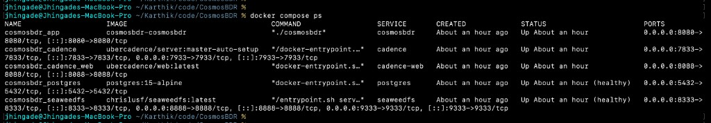

# Configuration

CosmosBDR splits configuration into two files:

| File | Commit to git? | Contains |
|------|----------------|----------|
| **`sources.yaml`** | Yes | Source topology, retention, schedules, `pre_backup`, non-secret SSH params |
| **`.env`** | No | Secrets, paths, infrastructure endpoints, encryption key |

The server **refuses to start** if `sources.yaml` fails validation or references undefined/empty environment variables.

---

## `sources.yaml`

Top-level shape:

```yaml
version: 1
sources:
  - id: <unique-source-id>
    type: local | sftp
    # type-specific fields...
    retention:
      ttl_days: 90
    schedules: []   # optional Cadence crons
```

### Global rules

- **`version`** — must be `1`.
- **`sources[].id`** — unique string; becomes `source_id` in API requests and part of `backup_key` (`source_id:relative_path`).
- **Unknown keys** are rejected at parse time (`KnownFields` strict decoding).

### Source type: `local`

For files on the host directory bind-mounted into the container (`HOST_DATA_PATH` → `/host-data`).

| Field | Required | Description |
|-------|----------|-------------|
| `id` | yes | Logical name, e.g. `local-host-data` |
| `type` | yes | `local` |
| `container_mount` | yes | Path inside the app container, typically `/host-data` |
| `retention.ttl_days` | no | Days to retain snapshots; `0` or omit disables expiry GC for this source |
| `schedules` | no | Cron rows (see [Backup workflow](backup-workflow.md)) |

**Invalid on `local`:** `host`, `user`, `remote_root`, `ssh`, `pre_backup`.

### Source type: `sftp`

Remote files over SSH/SFTP (Windows OpenSSH, Linux, etc.).

| Field | Required | Description |
|-------|----------|-------------|
| `id` | yes | Logical name |
| `type` | yes | `sftp` |
| `host` | yes | Hostname/IP, or `env:VAR_NAME` |
| `port` | no | Default `22` |
| `user` | yes | SSH user, or `env:VAR_NAME` |
| `remote_root` | yes | Base directory on remote; all paths are under this, or `env:VAR_NAME` |
| `domain` | no | Optional Windows domain |
| `ssh` | yes (practical) | See below |
| `pre_backup` | no | Remote hook before backup (SFTP only) |
| `dump_freshness` | no | Reject stale dump artifacts |
| `retention` / `schedules` | no | Same as local |

#### `ssh` block

| Field | Description |
|-------|-------------|
| `secret_ref` | Env var name containing **OpenSSH private key PEM** (newlines as `\n`) |
| `password_ref` | Env var for SSH password (use with key or alone) |
| `known_hosts_policy` | Only `pinned` (or omit) |
| `host_key_fingerprint` | `SHA256:…` from `ssh-keygen -lf -`, or `env:VAR` |
| `proxy_jump` | Optional bastion host |

At least one of `secret_ref` or `password_ref` must resolve to a non-empty value.

#### `pre_backup` block (optional)

Runs **once per backup job** (single-file or directory parent) via SSH exec—commands come **only** from YAML, never from HTTP.

| Field | Description |
|-------|-------------|
| `command` | argv list, e.g. `bash`, `-lc`, multi-line script |
| `env_refs` | Map of remote env var → `.env` key (e.g. `PGPASSWORD: PROD_DB_VM_PG_PASSWORD`) |
| `output.relative_path` | File under `remote_root` to back up (overrides API `relative_path` for single-file jobs when set) |
| `output.cleanup_after` | Delete remote staging file after successful backup |

Use a **dedicated `source_id`** for DB dump hooks so other paths on the same host do not run `pg_dump`. See [Backup workflow — DB dumps](backup-workflow.md#database-dumps-postgres-mysql-and-more).

#### `dump_freshness` (optional)

| Field | Description |
|-------|-------------|
| `max_age_hours` | Maximum age of file mtime before inspect fails |
| `relative_paths` | Paths under `remote_root` to check |

Prevents silent **SKIP** when tonight's dump failed but last night's file is unchanged.

#### `schedules[]`

| Field | Default | Description |
|-------|---------|-------------|
| `id` | — | **Globally unique**; Cadence workflow id becomes `scheduled_backup_<id>` |
| `relative_path` | — | File or directory root under source |
| `schedule` | — | Cron expression (5-field, Cadence) |
| `enabled` | `true` | `false` validates but does not register cron |
| `directory` | — | If set, directory backup scope (see [Backup workflow](backup-workflow.md)) |

Example: [`sources.yaml`](../sources.yaml) in the repo root.

---

## Environment variables (`.env`)

Copy from [`.env.example`](../.env.example). Groups below.

### Application

| Variable | Default | Description |
|----------|---------|-------------|
| `PORT` | `8080` | HTTP listen port |
| `SOURCES_CONFIG_PATH` | `sources.yaml` | Path to source registry file |
| `ENCRYPTION_KEY` | dev default | 32-byte hex (preferred) or 32-char string for AES-256-GCM |
| `COMPRESSION_ALGORITHM` | `gzip` | `gzip` or `zstd` for chunk payload compression |

### Docker bind mounts

| Variable | Description |
|----------|-------------|
| `HOST_DATA_PATH` | Host directory → `/host-data` in container (local backups) |
| `SEAWEED_DATA_PATH` | Seaweed volume data |
| `POSTGRES_DATA_PATH` | Postgres data directory |

Keep Seaweed/Postgres paths **separate** from backup source data.

### Postgres (metadata)

| Variable | Default | Description |
|----------|---------|-------------|
| `POSTGRES_DB_USERNAME` | `postgres` | |
| `POSTGRES_DB_PASSWORD` | `postgres` | |
| `POSTGRES_DB_HOST` | `localhost` | `postgres` inside Compose |
| `POSTGRES_DB_PORT` | `5432` | |
| `POSTGRES_DB_NAME` | `cosmosbdr` | Application DB |
| `POSTGRES_DB_SSL` | `disable` | |
| `POSTGRES_DB_MIGRATIONS_DIRECTORY` | `src/db/migrations` | Used by Atlas job |

### SeaweedFS (S3)

| Variable | Default | Description |
|----------|---------|-------------|
| `SEAWEED_ENDPOINT` | `http://localhost:8333` | S3 API URL |
| `SEAWEED_REGION` | `region` | Passed to AWS SDK |
| `SEAWEED_ACCESS_KEY` | — | 16 hex chars (Seaweed convention) |
| `SEAWEED_SECRET_KEY` | — | 32 hex chars |
| `SEAWEED_BUCKET` | `cosmosbdr` | Created on startup if missing |
| `SEAWEED_OBJECT_LOCK_ENABLED` | `true` | COMPLIANCE lock; see [worm-runbook.md](worm-runbook.md) |

### Cadence

| Variable | Default | Description |
|----------|---------|-------------|
| `CADENCE_GRPC_HOST` | `localhost` | Worker + client |
| `CADENCE_GRPC_PORT` | `7233` / `7933` | `7933` in Compose |
| `CADENCE_UI_HOST` | — | Documentation / links only |
| `CADENCE_UI_PORT` | `8088` | Web UI |
| `CADENCE_MAX_CONCURRENT_WORKFLOWS` | `5` | Directory backup child workflow batch |
| `CADENCE_WORKER_MAX_CONCURRENT_ACTIVITIES` | `10` | Global activity concurrency |

### Retention garbage collection

| Variable | Default | Description |
|----------|---------|-------------|
| `RETENTION_GC_WORKFLOW_ID` | `retention_gc_daily` | Cadence cron workflow id |
| `RETENTION_GC_CRON_SCHEDULE` | `0 3 * * *` | Daily GC time (UTC in container) |
| `RETENTION_GC_ITEM_BATCH_SIZE` | `200` | Job items per GC batch |
| `RETENTION_GC_ORPHAN_BATCH_SIZE` | `500` | Orphan chunk deletes per batch |
| `RETENTION_GC_EXECUTION_TIMEOUT_HOURS` | `3` | Workflow timeout |

### Per-source secrets (naming convention)

For source id `win-home-laptop`, use prefix `WIN_HOME_LAPTOP_`:

- `WIN_HOME_LAPTOP_HOST`
- `WIN_HOME_LAPTOP_USER`
- `WIN_HOME_LAPTOP_REMOTE_ROOT`
- `WIN_HOME_LAPTOP_SSH_KEY` (referenced by `ssh.secret_ref` in YAML)
- `WIN_HOME_LAPTOP_HOST_KEY_FINGERPRINT`

For source id `prod-db-vm`, use prefix `PROD_DB_VM_` (see [`.env.example`](../.env.example)): `HOST`, `USER`, `REMOTE_ROOT`, `SSH_PASSWORD` or `SSH_KEY`, `HOST_KEY_FINGERPRINT`, `PG_PASSWORD`.

Rules:

- YAML uses `env:WIN_HOME_LAPTOP_HOST` or `secret_ref: WIN_HOME_LAPTOP_SSH_KEY`.
- Every `env:` and `*_ref` in YAML must exist and be non-empty in `.env` at startup.

---

## First-time setup

1. `cp .env.example .env` and fill required paths/secrets.
2. `sources.yaml` validates against your env refs (`go test ./src/config/...` includes YAML tests).
3. `docker compose up -d --build` then `docker compose ps` — all services **Up**; **postgres** and **seaweedfs** report **healthy**.



4. `GET /api/v1/sources` lists non-secret source summaries.

Next: [Backup workflow](backup-workflow.md) · [API reference](api-reference.md)