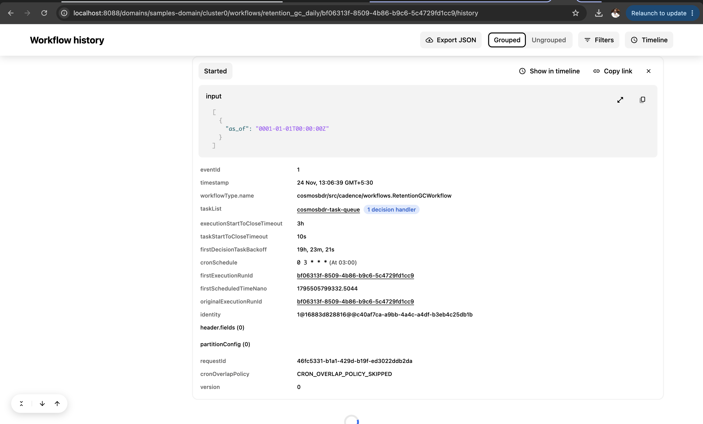

# Garbage collection (retention)

CosmosBDR enforces **per-source TTL** from `sources.yaml` (`retention.ttl_days`) and reclaims **unreferenced chunk blobs** in Seaweed. A dedicated Cadence cron workflow runs on a global schedule from `.env`.

---

## Two layers of retention

| Layer | Mechanism | Config |
|-------|-----------|--------|
| **Snapshot eligibility** | Postgres job items past TTL marked ineligible; list/restore APIs ignore them | `sources[].retention.ttl_days` |
| **Blob deletion** | S3 `DeleteObject` with `versionId` for orphaned or expired chunks | `RetentionGCActivity` batches |
| **WORM** | COMPLIANCE lock blocks delete until `retain_until` | `SEAWEED_OBJECT_LOCK_ENABLED` + TTL at upload time |

`sources` with `ttl_days: 0` or omitted retention skip **expiry** for that source (chunks may still be deleted if unreferenced globally).

---

## Cadence cron

Registered at startup from `.env`:

| Variable | Default | Meaning |
|----------|---------|---------|
| `RETENTION_GC_WORKFLOW_ID` | `retention_gc_daily` | Stable workflow id |
| `RETENTION_GC_CRON_SCHEDULE` | `0 3 * * *` | Daily run (03:00 container local time) |
| `RETENTION_GC_EXECUTION_TIMEOUT_HOURS` | `3` | Workflow cap |



Workflow type: `cosmosbdr/src/cadence/workflows.RetentionGCWorkflow`

Overlap policy: **skip** if previous GC still running (same as backup schedules).

---

## What one GC run does

```text
RetentionGCWorkflow
  → RetentionGCActivity (batched)
       1. Expire job items older than source ttl_days (per-source policy)
       2. Delete Seaweed object versions for chunks no longer referenced
       3. Respect object lock — count skips as blobs_skipped_object_lock
```

Batch sizes:

| Variable | Default |
|----------|---------|
| `RETENTION_GC_ITEM_BATCH_SIZE` | `200` |
| `RETENTION_GC_ORPHAN_BATCH_SIZE` | `500` |

---

## WORM interaction

When `SEAWEED_OBJECT_LOCK_ENABLED=true`:

- Upload sets `retain_until ≈ snapshot_time + ttl_days` (COMPLIANCE mode).
- GC attempts versioned delete; **locked** objects remain until retention ends.
- Metrics/logs include skipped blob counts — not a failure.

**Not protected:** Seaweed **filer UI** trash, raw volume deletion — see [worm-runbook.md](worm-runbook.md).

Integration test and manual S3 delete demo: [worm-runbook.md — automated integration tests](worm-runbook.md#automated-integration-tests) and [manual S3 delete](worm-runbook.md#manual-s3-delete-production-chunk).

```bash
export SEAWEED_INTEGRATION=1
go test -tags=integration -run TestWORM ./src/storage/
```

---

## Operator checklist

1. Set realistic `ttl_days` per source (legal/compliance window).
2. Ensure GC cron timezone matches expectations (container clock).
3. After lowering TTL, **existing** snapshots keep their original `retain_until` on WORM uploads (no retroactive shorten).
4. Monitor Cadence: `retention_gc_daily` should complete within timeout.
5. For production, restrict filer `:8888` exposure.

---

## Related

- [Configuration — retention env vars](configuration.md#retention-garbage-collection)
- [Backup workflow — TTL at snapshot time](backup-workflow.md#encryption-deduplication-worm)
- [WORM runbook](worm-runbook.md)