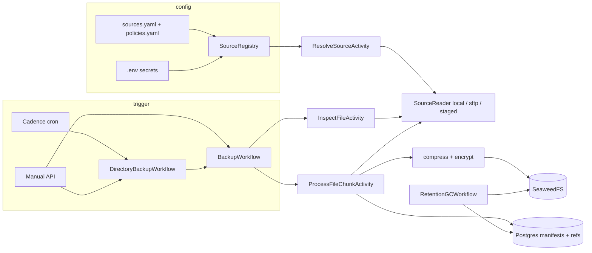

# CosmosBDR: Multi-Source Backup & Platform Strategy

Living design doc for phased implementation. Reference this document when building any step/phase.

**Last updated:** 2026-11-20 (locked restore, retention, config validation decisions)

---

## Current baseline (what exists today)

- **Ingress:** HTTP triggers → Cadence `BackupWorkflow` / `RestoreWorkflow` (restore is manual).
- **Source data:** Host folder bind-mounted as `/host-data` via `HOST_DATA_PATH` in `docker-compose.yml` (backup *source*, not Seaweed).
- **Pipeline:** Single file per job → `InspectFile` (size/mtime/hash, SKIP + chunk clone) → fixed 4 MB chunks → content-hash dedup → SeaweedFS (S3 API) → Postgres job/item/chunk metadata + snapshot manifest.
- **Versions:** List/restore by logical path; optional `source_job_item_id` pins a version (default latest eligible).
- **Encrypt/compress:** Config exists in `.env` (`ENCRYPTION_KEY`, `COMPRESSION_ALGORITHM`); chunk I/O not fully wired yet.

---

## Strategic goal

Treat every backup target as a **logical item** with a stable identity, backed by a **pluggable source reader**. The chunk → encrypt/compress → Seaweed → Postgres manifest path stays the same; only ingestion, orchestration (directory, schedule, retention), and restore targets evolve.

---

## 1. Configuration model (YAML + `.env`)

### Files (suggested layout next to `.env`)

| File | Check in? | Contents |
|------|-----------|----------|
| `sources.yaml` | Yes | Source definitions, non-secret connection params |
| `backup-policies.yaml` | Yes | What to back up, schedules, retention, directory rules |
| `.env` | No | SSH keys/passphrases, key paths, `ENCRYPTION_KEY`, etc. |

### Secret resolution

- In YAML: **references only**, e.g. `ssh_secret_ref: PROD_WEB01_SSH_PRIVATE_KEY` (PEM in env) or path via env.
- Startup: load YAML → validate schema → resolve refs from env → **SourceRegistry** (immutable after load).
- **Known hosts:** prefer pinned `host_key_fingerprint` in YAML (commit-safe) over disabling host key verification.

### Validation & loading (`src/config/`)

- **Schema + structs:** JSON Schema (or equivalent) definitions, YAML → Go struct mapping, and `SourceRegistry` loader live under **`src/config/`** (alongside existing env config).
- **Fail fast:** if `sources.yaml` / `backup-policies.yaml` fail validation, required fields are missing, or mandatory secrets from `.env` cannot be resolved, the **server must not start** (log explicit errors and exit non-zero).
- **CI (recommended later):** same validation in a test or `go run` check so bad YAML never merges.

### Example source record

```yaml
version: 1
sources:
  - id: local-host-data
    type: local
    container_mount: /host-data

  - id: prod-app-01
    type: sftp
    host: prod-app-01.example.com
    port: 22
    user: cosmosbdr-backup
    domain: production
    remote_root: /var/lib/myapp/data
    ssh:
      secret_ref: PROD_APP01_SSH_KEY
      known_hosts_policy: pinned
      host_key_fingerprint: "SHA256:..."
      proxy_jump: bastion.example.com
    # Retention TTL is configured per source (see §6, §15)
    retention:
      ttl_days: 90
```

### Example policy record

```yaml
policies:
  - id: prod-config-nightly
    source_id: prod-app-01
    path: config/app.yml
    kind: file
    schedule: "0 2 * * *"
    enabled: true
```

Manual API triggers use `policy_id` or explicit `(source_id, path)`.

---

## 2. Source types & DB dumps

### Remote files: SFTP (not SCP as primary)

| Concern | SFTP | SCP |
|---------|------|-----|
| Stat / mtime / size | Yes | Awkward |
| Parallel `ReadAt(offset, len)` for 4 MB chunks | Yes | Whole-file copy |
| Fits `InspectFile` + `ProcessFileChunk` | Yes | Poor |

**SCP fallback (optional):** download entire file to temp, then run existing local pipeline—OK for small files / MVP only.

**Remote file flow:**

1. Open SSH/SFTP session (pool or per-workflow with retries).
2. Stat remote path → same decision ladder as today.
3. `ReadAt` per chunk activity instead of `os.Seek`/`Read`.

### DB dumps

- **Dump already on remote** (e.g. cron writes `/backups/db.sql.gz`): use **`sftp`** only—no separate DB source type.
- **CosmosBDR must create dump:** add **`db_dump`** (or pre-backup hook) that:
  1. SSH exec runs configured command (`pg_dump`, etc.; DB creds from env).
  2. Output to remote temp or worker staging.
  3. Same inspect/chunk/upload pipeline; logical name e.g. `postgres/prod-2026-11-20.dump`.

Use **`db_dump` source** when you need engine-specific flags, DB credentials separate from SSH, consistency (`pg_dump --snapshot`), or streaming. Otherwise “dump is a file” keeps the model simple.

**Restore v1:** restore **file to disk** (local or SFTP). DB **import** (`psql`/`pg_restore` over SSH) is a later, explicit feature.

---

## 3. Stable identity: `backup_key`

Do not key version history only on container-local paths.

```text
backup_key = "{source_id}:{normalized_relative_path}"
# e.g. prod-app-01:config/app.yml
```

Persist: `source_id`, `source_type`, logical path, optional display URI.

List/restore APIs accept `backup_key` or `(source_id, relative_path)`.

---

## 4. Source Reader abstraction

```text
SourceReader:
  Stat(ctx) → size, mtime, isDir
  ContentSHA256(ctx) → when tier-3 hash needed
  ReadAt(ctx, offset, length) → []byte
  List(ctx, prefix) → []Entry   # directories
```

| Implementation | Role |
|----------------|------|
| `LocalReader` | Current `os` under `/host-data` |
| `SFTPReader` | Remote ranged reads |
| `StagedFileReader` | After DB dump or SCP fallback |

### Activities (conceptual)

| Activity | Role |
|----------|------|
| `ResolveSourceActivity` | Request/policy → reader + paths |
| `InspectFileActivity` | Reader instead of `os` |
| `ProcessFileChunkActivity` | `ReadAt` |
| `ListDirectoryActivity` | Directory policies |
| `RestoreTargetActivity` (later) | Local or SFTP write |

Remote workloads: longer activity timeouts, tuned parallel chunk count.

---

## 5. Workflows

### Single file

Unchanged graph: Init → Inspect → chunk fan-out → manifest → finalize. Request carries `source_id` + path.

### Directory backup

**`DirectoryBackupWorkflow` (parent):**

1. List files (`include`/`exclude` globs, depth/size limits).
2. Child `BackupWorkflow` per file; concurrency cap (e.g. 5–10).
3. Parent tracks totals/failures; fail-fast vs best-effort policy.

Schema: optional `parent_job_id`, `policy_id` on job payload.

### Schedule vs restore

- **Backup:** Cadence cron per policy (or one scheduler workflow)—durable, visible in Cadence UI.
- **Restore:** manual HTTP only (no cron).

Alternatives later: in-process `robfig/cron` or external cron → API.

---

## 6. Retention TTL & chunk GC

Two lifecycles:

1. **Versions:** `job_items` + manifests (including SKIPPED) in Postgres.
2. **Blobs:** Seaweed chunk objects on the **CosmosBDR host** (bind-mounted `SEAWEED_DATA_PATH`; see §13–§14).

**TTL (locked decision):**

- **`ttl_days` (or equivalent) is set on each entry in `sources.yaml`** (source-level default for all `backup_key`s under that source).
- When a backup version’s age **exceeds the source TTL**, expire that version’s **metadata** (job_items, manifests, item_chunk links for that version only).

**Physical delete (not WORM):**

- We do **not** rely on Seaweed WORM/object-lock for v1. After TTL, eligible data is **removed for real**.
- **Chunk objects** in Seaweed are deleted only when **no remaining `item_chunk` row references them** (global refcount). Shared chunks from dedup must survive while any **in-TTL or newer** version still points at them.
- Order: expire version metadata → remove that version’s chunk links → **GC pass** deletes unreferenced chunks from Seaweed and orphan `chunks` rows if applicable.

**SKIPPED** versions count toward history and TTL like any other completed snapshot.

**`RetentionGCWorkflow`:** daily Cadence cron, separate from backup; applies per-source TTL from config loaded at startup.

---

## 7. Encrypt & compress

**Order:**

```text
plaintext segment → SHA-256 (dedup key)
                 → compress (gzip/zstd)
                 → encrypt (AES-256-GCM, per-object nonce)
                 → Seaweed upload
```

- Dedup on **plaintext hash** (app-level); skip upload when hash exists.
- Store: `compression_alg`, encrypted flag, `compressed_size_bytes`.
- Restore: download → decrypt → decompress → write; verify hash.

Shared `chunkcodec` for backup and restore.

---

## 8. Docker & SSH

- Keys: env PEM or read-only secret mount—never in image.
- Pinned host key fingerprint in YAML.
- App must reach `host:22` (or `proxy_jump`).
- SFTP connection/channel limits → lower parallelism for remote policies.
- **Local source:** `HOST_DATA_PATH` → `/host-data`.

---

## 9. API evolution (minimal)

**Backup store vs restore target (locked):**

- **All backup bytes** live in **SeaweedFS** on the machine running CosmosBDR, with chunk data on a **host bind-mounted path** (`SEAWEED_DATA_PATH`). Remote SFTP/SSH paths are **sources only**—never the durability tier.
- **Restore (default):** read chunks from Seaweed → decrypt/decompress → write to a **local filesystem path** on the CosmosBDR host (e.g. under `/host-data` or an explicit local `target_path` in the API). **No default push-back over SFTP** in v1; remote push-restore can be a later optional phase.

**Endpoints (conceptual):**

- **Backup:** `{ "policy_id" }` or `{ "source_id", "relative_path" }`.
- **List:** by `backup_key` or `source_id` + path.
- **Restore:** `{ "backup_key", "source_job_item_id?", "target_path": "/host-data/..." }` — `target_path` optional; default reconstructs under local source mount using stored logical/`backup_key` layout.

---

## 10. Phased delivery

| Phase | Deliverable |
|-------|-------------|
| **A** | YAML in `src/config/` (schema, structs, loader), fail-fast startup, `SourceRegistry`, `backup_key` in DB/API |
| **B** | `SFTPReader` + refactor inspect/chunk to `SourceReader` (single file) |
| **C** | Policies + manual trigger by `policy_id` |
| **D** | Directory parent workflow + globs |
| **E** | Cadence cron per policy |
| **F** | Retention + chunk GC workflow |
| **G** | Encrypt/compress in chunk pipeline + restore |
| **H** | `db_dump` pre-step (SSH exec + stage) |

---

## 11. Decisions to lock early

1. `backup_key = source_id:relative_path`
2. SFTP primary; SCP staging fallback only
3. DB: file backup when dump exists; `db_dump` when dump must be created
4. Cadence cron for backup; restore API-only
5. Plaintext-hash dedup, encrypted blobs in Seaweed
6. **Backup durability:** always Seaweed on CosmosBDR host (bind mount); remotes are ingest sources only
7. **Restore default:** local filesystem on CosmosBDR host (from Seaweed); no SFTP push-back in v1
8. **Retention:** `ttl_days` per **source**; physical delete of expired metadata + unreferenced chunks (no WORM v1)
9. **Config:** validate `sources.yaml` / `backup-policies.yaml` in `src/config/`; **abort server start** on any validation or mandatory env resolution failure

---

## 12. Architecture diagram



---

## 13. SeaweedFS storage & host bind mounts

### How it works today (`docker-compose.yml`)

| Mount | Purpose |
|-------|---------|
| `${HOST_DATA_PATH}:/host-data` | **Backup source** data (files you protect)—explicit host path |
| `seaweeddata:/data` (Docker **named volume**) | **SeaweedFS backend**—not a bind mount to a chosen host folder |

Named volume data lives in Docker’s volume store (on Docker Desktop for Mac, inside the Linux VM disk image), not as an obvious folder like `~/Downloads/...`.

Postgres uses the same pattern: `pgdata` named volume.

### Docker Desktop (Mac): limits & crash recovery

| | **Named volume** (`seaweeddata`, `pgdata`) | **Bind mount** (host path) |
|---|--------------------------------------------|----------------------------|
| **Where data lives** | Inside the Linux VM **virtual disk** | On the Mac filesystem (path you choose) |
| **Effective size cap** | Docker **Settings → Resources → Virtual disk limit**, shared with images, other volumes, build cache | Mac disk free space |
| **Docker stop / restart** | Usually persists | Persists |
| **VM corrupt, factory reset, “delete all data”** | **High risk of loss** unless exported | Folder **survives** on the host |
| **Backup / inspect** | Opaque (`docker volume` tooling) | Finder, Time Machine, `rsync`, normal paths |

The concern is usually **not** a per-volume quota, but **all chunk data competing for space inside one capped VM disk**—backups grow, the VM disk fills, and every service suffers.

### Should SeaweedFS be bind-mounted to the local host?

**Dev / laptop (this project):** **Prefer bind mounts** for Seaweed (and consider the same for Postgres metadata) so chunk/job data is not trapped inside the Docker VM. Named volumes are acceptable for throwaway experiments only.

**Production / DR seriousness:** **Prefer explicit durable storage**, not an anonymous named volume on a single laptop:

| Approach | When |
|----------|------|
| **Bind mount** e.g. `./data/seaweed:/data` or `/var/lib/cosmosbdr/seaweed:/data` | Single-node prod, clear backup-of-backup, rsync snapshots |
| **Dedicated disk/volume** (EBS, PVC in K8s, managed NFS) | Prod default |
| **Remote object store** (Seaweed alongside or migration to S3-compatible external bucket) | Multi-AZ, avoid single Docker host as SOLE copy of chunks |

**Important separation:**

- **`HOST_DATA_PATH`** = sources being backed up (may be remote via SFTP later; mount is for *local* sources).
- **Seaweed volume** = immutable chunk store (the DR artifact). Losing the host source without Seaweed loses nothing; losing Seaweed loses all backups.

### Recommendations

1. **Do not** bind-mount Seaweed to the same tree as `HOST_DATA_PATH` (avoid backing up the backup store accidentally without policy).
2. **Do** document a host path or cloud volume for Seaweed in prod; add bind mount or PVC when you leave pure local dev.
3. **Do** plan 3-2-1: Postgres metadata + Seaweed blobs replicated or snapshotted off the app host.
4. Encrypt/compress at chunk layer (Phase G) complements—not replaces—storage redundancy.

### Target compose pattern (bind mount)

```yaml
# seaweedfs service — SEAWEED_DATA_PATH must be set in .env (no compose default)
volumes:
  - ${SEAWEED_DATA_PATH}:/data

# postgres service — POSTGRES_DATA_PATH must be set in .env
volumes:
  - ${POSTGRES_DATA_PATH}:/var/lib/postgresql/data
```

---

## 14. What we'd do in this setup (ordered checklist)

Track infrastructure hygiene **before** multi-source phases (Section 10). Do these in order; check off as implemented.

### Prerequisite: durable Docker data on the Mac

- [x] **1. Pick host paths** (keep separate from backup *sources* and from each other):
  - Sources (already): `HOST_DATA_PATH` → `/host-data` (e.g. test/customer files).
  - Chunk store: `SEAWEED_DATA_PATH` (e.g. sibling `cosmosbdr_data/seaweed` — absolute path in `.env`).
  - Job DB: `POSTGRES_DATA_PATH` (e.g. `cosmosbdr_data/postgres`).
  - **Do not** nest Seaweed under `HOST_DATA_PATH` (avoid sweeping the backup store into a source directory policy later).

- [x] **2. Create directories on the host** before first `docker compose up` with new mounts.

- [x] **3. Add env vars** to `.env` and `.env.example`:
  - `SEAWEED_DATA_PATH`
  - `POSTGRES_DATA_PATH` (if binding Postgres)

- [x] **4. Update `docker-compose.yml`**: replace named volumes `seaweeddata` and (if desired) `pgdata` with the bind mounts above; remove unused entries under top-level `volumes:` if nothing else needs them.

- [x] **5. Data layout**: durable paths live outside the repo (e.g. sibling `cosmosbdr_data/`); no in-repo `data/` tree required. Add `.gitignore` entries only if you use repo-relative mount dirs again.

- [ ] **6. Migrate or reset data** (one-time, when switching from named volumes):
  - **Fresh start:** remove old named volumes (`docker volume rm ...`), empty new host dirs, re-run backups.
  - **Keep existing chunks:** copy from old volume to host path (e.g. temp container mount) *before* cutting over compose—otherwise history in Postgres may not match files on disk.

- [ ] **7. Document / verify:** after cutover, confirm Seaweed objects land under `SEAWEED_DATA_PATH` on the Mac and Postgres files under `POSTGRES_DATA_PATH` if used.

- [ ] **8. Off-host copy (when serious about DR):** Time Machine, rsync, or second location for **both** Seaweed data and Postgres data (3-2-1). Bind mount on laptop is not a substitute for a second copy.

### Then: multi-source & product phases (Section 10)

Only start **Phase A** (YAML, `SourceRegistry`, `backup_key`) after **1–7** are done—or explicitly accept named volumes for a short-lived dev spike.

| Order | Track | Section |
|-------|-------|---------|
| Infra | Prerequisite checklist above | §14 |
| A | YAML schema, loader, `SourceRegistry`, `backup_key` | §10 |
| B | `SFTPReader` + `SourceReader` refactor | §10 |
| C | Policies + manual `policy_id` trigger | §10 |
| D | Directory workflow | §10 |
| E | Cadence cron | §10 |
| F | Retention + chunk GC | §10 |
| G | Encrypt/compress pipeline | §10 |
| H | `db_dump` pre-step | §10 |

### Status log (fill in as you go)

| Item | Status | Notes |
|------|--------|-------|
| Seaweed bind mount | done | `cosmosbdr_data/seaweed` via `.env` |
| Postgres bind mount | done | `cosmosbdr_data/postgres` via `.env` |
| Volume migration | | |
| Phase A | done | YAML, registry, backup_key, APIs |
| Phase B | done | SFTP `SourceReader`, inspect/chunk via `sourceread` |
| SFTP ops runbook | done | [sftp-sources-runbook.md](./sftp-sources-runbook.md) — Docker LAN, `.env` per source, backup/restore |

---

## 15. Locked product decisions (formerly open questions)

| Topic | Decision | Implication |
|-------|----------|-------------|
| **Where backups live** | All chunk/manifest storage in **Seaweed** on the **local host** running the server (`SEAWEED_DATA_PATH` bind mount). | Ingest from local mount or remote SFTP; durability is always central Seaweed + Postgres on this host. |
| **Restore default** | **Local only** for v1: restore reads Seaweed and writes to a path on the CosmosBDR host (default under `/host-data` or explicit `target_path`). | `RestoreWorkflow` stays filesystem-targeted; SFTP upload-restore is out of scope until explicitly scheduled. |
| **WORM vs TTL** | **No WORM** for v1. **TTL per source** in `sources.yaml`. After TTL, delete **version metadata** and **physically remove** Seaweed objects / chunk rows that are **no longer referenced**. | Phase F implements refcount-safe GC; deduped chunks shared with newer backups are never deleted early. |
| **YAML validation** | Schemas, struct mapping, and loader in **`src/config/`**. | Missing/invalid YAML or unresolved mandatory secrets → **process exits**; no degraded “empty registry” mode. |

_No remaining open items in this list; add new rows here when scope changes._