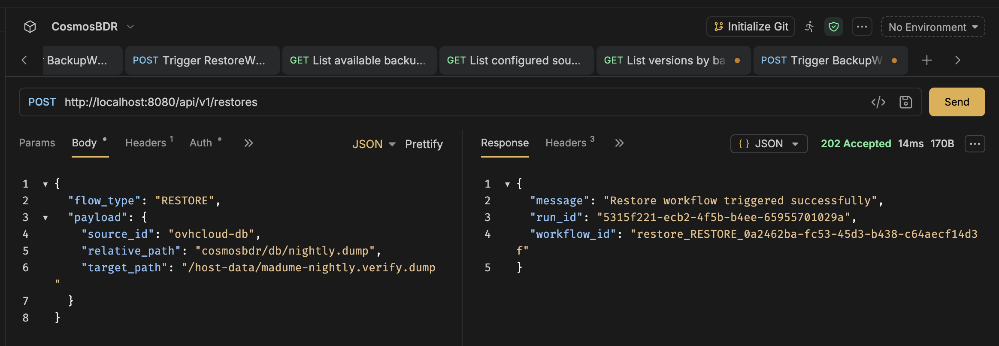
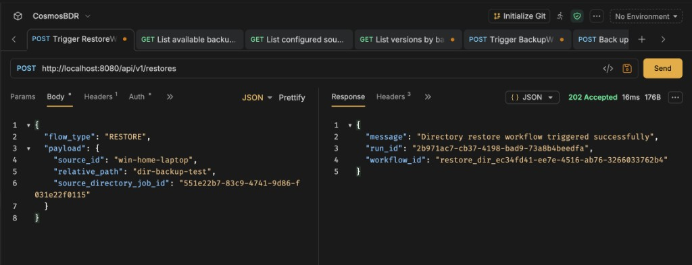
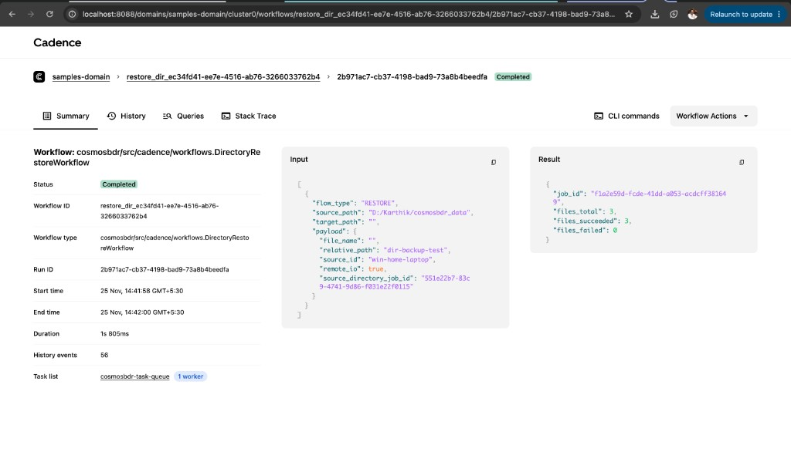
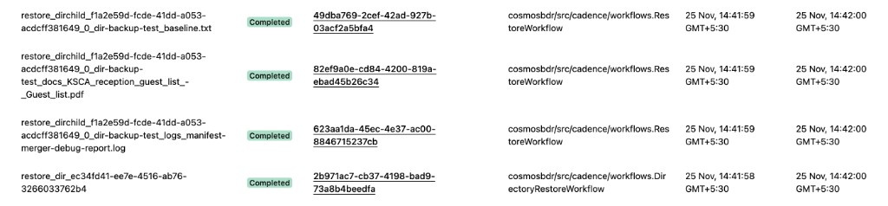
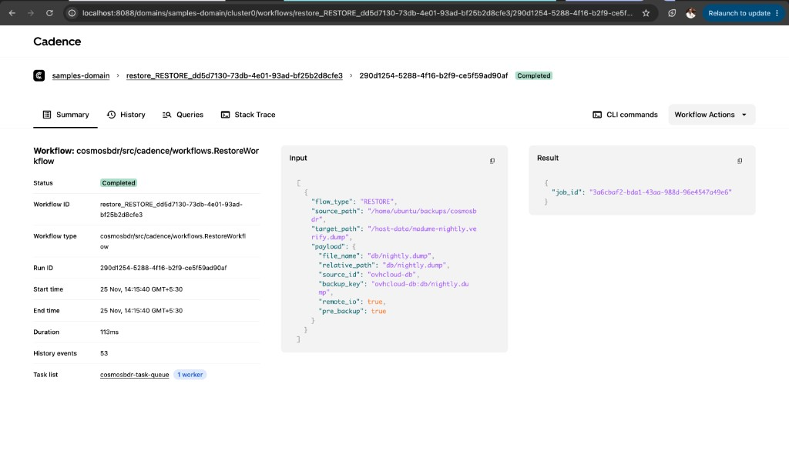

# Restore

Restore workflows **read snapshot metadata from Postgres**, fetch encrypted chunks from Seaweed, decrypt/decompress, and write bytes to a **target path** on a local mount or remote SFTP host.

Triggers are **manual** (HTTP API only)—there is no “restore schedule.”

---

## Workflows

| Mode | Cadence workflow | Workflow id prefix |
|------|------------------|--------------------|
| Single file | `RestoreWorkflow` | `restore_RESTORE_…` |
| Directory tree | `DirectoryRestoreWorkflow` | `restore_dir_…` |



---

## Choosing a version

List candidates first:

```http
GET /api/v1/backups?backup_key=prod-db-vm:db/nightly.dump
```

or legacy:

```http
GET /api/v1/backups?source_path=/host-data&file_name=e2e_test_asset_v2.dat
```

Response entries include:

| Field | Use |
|-------|-----|
| `job_item_id` | Pin this exact snapshot on restore |
| `status` | `COMPLETED` or `SKIPPED` (both are restorable) |
| `checksum` | SHA-256 of original file (verify after restore) |
| `backed_up_at` | Snapshot time |

**Default:** omit `source_job_item_id` → latest **eligible** backup for the path / key.

**Pin version:**

```json
"payload": {
  "file_name": "e2e_test_asset_v2.dat",
  "source_job_item_id": "7551b353-ff80-4579-b5a0-08a4c68aeefb"
}
```

---

## Single-file restore

### Preferred: `source_id` + `relative_path`

From the Bruno request *Restore DB dump onto local system* (`CosmosBDR.zip`):

```http
POST /api/v1/restores
Content-Type: application/json

{
  "flow_type": "RESTORE",
  "target_path": "/host-data/nightly.verify.dump",
  "payload": {
    "source_id": "prod-db-vm",
    "relative_path": "db/nightly.dump"
  }
}
```

**Response** `202 Accepted`:

```json
{
  "message": "Restore workflow triggered successfully",
  "workflow_id": "restore_RESTORE_0a2462ba-…",
  "run_id": "5315f221-ecb2-4f5b-b4ee-65955701029a"
}
```

| Field | Description |
|-------|-------------|
| `target_path` | Destination file path (local mount path inside container, or resolved SFTP path) |
| `source_id` | Registry source whose **backup catalog** to read (not necessarily where bytes are written) |
| `relative_path` | Logical item path used at backup time |

### Legacy local restore

*Trigger RestoreWorkflow [Default latest backup]* in `CosmosBDR.zip`:

```json
{
  "flow_type": "RESTORE",
  "source_path": "/host-data",
  "target_path": "/host-data",
  "payload": {
    "file_name": "e2e_test_asset_v2.dat",
    "source_job_item_id": "<optional-uuid>"
  }
}
```

`source_path` + `file_name` locate the backup row; `target_path` is where bytes are written (can differ for “restore copy” tests).

---

## Directory restore

Set `payload.directory` (and optionally `source_directory_job_id` to pin a specific directory backup parent job).

Typical flow:

1. Resolve directory scope (same glob/regex language as backup, or restore-all from a pinned parent job).
2. `ListDirectoryRestoreActivity` builds file list + version per path.
3. Child `RestoreWorkflow` per file.

Use when recovering a folder tree (e.g. `dir-backup-test/` on Windows SFTP) instead of one artifact.

Pin the directory backup parent job id from Cadence (`InitJob` on the `backup_dir_…` workflow):

```bash
curl -s -X POST http://localhost:8080/api/v1/restores \
  -H 'Content-Type: application/json' \
  -d '{
    "flow_type": "RESTORE",
    "payload": {
      "source_id": "win-home-laptop",
      "relative_path": "dir-backup-test",
      "source_directory_job_id": "551e22b7-83c9-4741-9d86-f031e22f0115"
    }
  }' | jq .
```

**Response** `202` — `restore_dir_…`; result example: `files_total: 3`, `files_succeeded: 3`.







Omit `target_path` to write each file back to **`remote_root` + relative path** on the SFTP host. See [SFTP sources runbook](sftp-sources-runbook.md) for filters (`directory` block) and latest-version restores.

---

## Remote (SFTP) targets

When `target_path` resolves against an SFTP source:

- Writes go to `remote_root` + relative destination.
- Host key still **pinned** via `sources.yaml` / `.env`.

See [SFTP sources runbook](sftp-sources-runbook.md) for connectivity from Docker.

---

## Database dump recovery

CosmosBDR restore **does not import** into a database engine.

| Step | Owner |
|------|--------|
| 1. `POST /api/v1/restores` | CosmosBDR writes `.dump` / `.sql` to `target_path` |
| 2. `pg_restore` / `psql` / `mysql` | Operator on DB host |

### Verify restored dump checksum

```bash
shasum -a 256 /path/to/nightly.verify.dump
curl -s 'http://localhost:8080/api/v1/backups?backup_key=prod-db-vm:db/nightly.dump' | jq '.backups[0].checksum'
```



For Dockerized Postgres on the VM, copy dump into container volume or `docker exec` import — outside Cosmos scope today.

---

## Pipeline (single file)

```text
ResolveRestoreSourceActivity     (pick job_item + chunks)
  → PrepareRestoreTargetActivity   (create/truncate target)
  → RestoreFileChunkActivity × N
  → FinalizeJob
```

Watch progress in Cadence Web alongside backup workflows.

---

## Failure modes

| Symptom | Likely cause |
|---------|----------------|
| `unknown source_id` | Typo in payload |
| No eligible backup | Path never backed up or GC expired all versions |
| SFTP write error | Permissions, disk full, host key mismatch |
| WORM | Cannot delete Seaweed blobs early; restore **reads** only — unaffected |

---

## Related

- [Backup workflow](backup-workflow.md)
- [API reference](api-reference.md)
- [Garbage collection](garbage-collection.md) — expired items disappear from list APIs