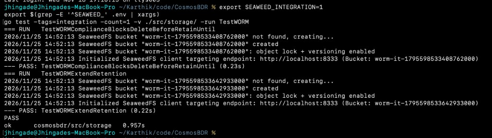
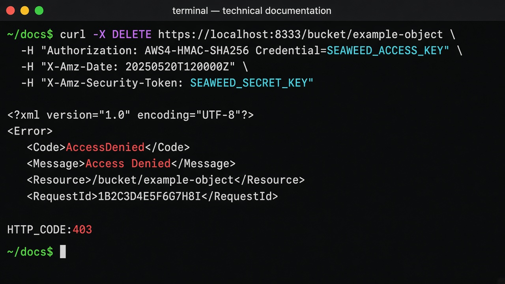

# WORM / S3 Object Lock runbook

Seaweed **COMPLIANCE** object lock for backup chunks and manifests. Background: [retention & WORM](architecture.md#worm--object-immutability) in the architecture reference.

---

## Enable

1. Set `SEAWEED_OBJECT_LOCK_ENABLED=true` in `.env` (app default is `true` in code; set `false` for dev without a lock-capable bucket).
2. Set `retention.ttl_days` **> 0** on each source in `sources.yaml` (lock applies per snapshot as `retain_until = snapshot_time + ttl_days`).
3. Use a bucket **created with Object Lock + versioning**. `EnsureBucket` does this only when the bucket is **missing**. An existing bucket without lock cannot be upgraded — delete the bucket or reset Seaweed data, then restart the app so the bucket is recreated.
4. Restart CosmosBDR after changes.

---

## What WORM does and does not protect

CosmosBDR and retention GC delete blobs only via the **S3 API** (`DeleteObject` **with `versionId`**). That path is what COMPLIANCE retention is meant to block while `retain_until` is active (see integration tests below).

| Path | Protected by Object Lock? |
|------|---------------------------|
| **S3 API** `DeleteObject` + **`VersionId`** | **Yes** (intended WORM boundary for automation / stolen app keys) |
| **S3 API** `DeleteObject` without `VersionId` | Often creates a **delete marker** only; the locked version may still exist (AWS-like) |
| **Filer UI** (`:8888`, trash icon) | **No** — filer is a separate control plane; deletes there are **not** S3 Object Lock checks. Seaweed maintainers treat this like operator-level removal (“similar to removing hard drives”) and expect you to **restrict filer access** separately ([seaweedfs#8350](https://github.com/seaweedfs/seaweedfs/issues/8350)). |
| **Host volume** (`SEAWEED_DATA_PATH`) | **No** — physical / root access bypasses all software locks |

**Do not use the filer trash button as a WORM test.** If delete succeeds in the UI while `retain_until` is in the future, that is **expected on Seaweed** and means an operator (or anyone with filer access) can still destroy backups.

**Recommended smoke test:**

1. Run `go test -tags=integration -run TestWORM ./src/storage/` with `SEAWEED_INTEGRATION=1` (creates a disposable bucket, asserts versioned delete is **blocked**).
2. Optionally use S3 API/tools with **`--version-id`** on a known chunk — expect `AccessDenied` while retention is active (not filer UI).
3. Run **Retention GC** before `retain_until`: expect `blobs_skipped_object_lock` when blobs are still locked.

**Production hygiene:** bind filer to admin-only networks (or disable exposing `8888`), add filer auth if available, rely on **3-2-1** copies; WORM is **S3-version-delete** protection, not protection from filer or disk operators.

---

## Automated integration tests

Object-lock behavior against a live Seaweed S3 endpoint:

```bash
# stack up (Seaweed on :8333); use same keys as .env
export SEAWEED_INTEGRATION=1
export SEAWEED_ENDPOINT="${SEAWEED_ENDPOINT:-http://localhost:8333}"
export SEAWEED_ACCESS_KEY="..."
export SEAWEED_SECRET_KEY="..."
export SEAWEED_REGION="${SEAWEED_REGION:-us-east-1}"

go test -tags=integration -count=1 -v ./src/storage/ -run 'TestWORM'
```

Tests create a **disposable** lock-enabled bucket, upload with COMPLIANCE, and assert **delete is blocked** before `retain_until`.



---

## Manual S3 delete (production chunk)

After at least one locked backup, Postgres stores `chunks.seaweed_key` and `chunks.seaweed_version_id`. A versioned **S3** `DELETE` must return **`403 AccessDenied`** while `retain_until` is in the future.



**Do not treat HTTP 204 as a WORM success** — that usually means delete without a valid `versionId`, a delete marker, or a stale id. The proof is **`403` + `AccessDenied`**.

`psql -At` prints columns separated by **`|`** (pipe). Split on `|`, do not use bare `read` with default IFS.

```bash
cd /path/to/CosmosBDR
# Set SEAWEED_* from your secret store — do not paste real keys into docs/screenshots.
export SEAWEED_ENDPOINT="${SEAWEED_ENDPOINT:-http://localhost:8333}"
export SEAWEED_BUCKET="${SEAWEED_BUCKET:-cosmosbdr}"
export SEAWEED_ACCESS_KEY="…"
export SEAWEED_SECRET_KEY="…"
export AWS_DEFAULT_REGION="${SEAWEED_REGION:-us-east-1}"

ROW=$(docker exec cosmosbdr_postgres psql -U postgres -d cosmosbdr -At -c \
  "SELECT seaweed_key, seaweed_version_id
   FROM chunks
   WHERE retain_until > now() AND coalesce(seaweed_version_id,'') <> ''
   ORDER BY created_at DESC LIMIT 1;")

OBJECT_KEY=${ROW%%|*}
VERSION_ID=${ROW#*|}

if [ -z "$VERSION_ID" ] || [ -z "$OBJECT_KEY" ]; then
  echo "No locked chunk row — run a WORM backup first"
  exit 1
fi

ENC_KEY=$(python3 -c "import urllib.parse; print(urllib.parse.quote('''${OBJECT_KEY}''', safe='/'))")

curl -sS -w "\nHTTP_CODE:%{http_code}\n" \
  --aws-sigv4 "aws:amz:${AWS_DEFAULT_REGION}:s3" \
  --user "${SEAWEED_ACCESS_KEY}:${SEAWEED_SECRET_KEY}" \
  -X DELETE \
  "${SEAWEED_ENDPOINT}/${SEAWEED_BUCKET}/${ENC_KEY}?versionId=${VERSION_ID}"
```

Sanity counts:

```bash
docker exec cosmosbdr_postgres psql -U postgres -d cosmosbdr -c "
SELECT count(*) FILTER (WHERE retain_until > now() AND coalesce(seaweed_version_id,'') <> '') AS curl_ready
FROM chunks;"
```

---

## Volume migration (object lock)

When Seaweed uses a host bind mount (`SEAWEED_DATA_PATH`) and you are cutting over from named Docker volumes:

- **Fresh start:** wipe volume / empty host dir, recreate bucket with lock on first app start, re-run backups.
- **Keep chunks:** copy volume data to the bind mount **before** cutover; if the old bucket was not lock-enabled, plan a bucket recreate (same as enable step 3).

Postgres metadata and Seaweed paths must stay consistent.

---

## Limits of this release

| Topic | What to expect |
|-------|----------------|
| **S3 credentials** | One app identity for upload and GC; split writer/deleter roles is not configured separately. |
| **TTL changes** | Editing `ttl_days` does not rewrite `retain_until` on objects already uploaded. |
| **DR scope** | WORM protects blobs on this store; **3-2-1 off-host copy** is still required for site loss. |

---

## Verification (production)

After enable and at least one locked backup:

1. Bucket created with object lock + versioning (app log on first start).
2. Backup completes; filer shows `chunks/...` and `snapshots/.../manifest.json` with `.versions/`.
3. Postgres: `chunks.seaweed_version_id`, `chunks.retain_until`; item metadata includes manifest lock fields where applicable.
4. S3 versioned delete **blocked** before `retain_until` ([integration test](#automated-integration-tests) or [manual DELETE](#manual-s3-delete-production-chunk) — **not** filer trash).
5. `go test -tags=integration ... -run TestWORM` passes with `SEAWEED_INTEGRATION=1` when validating the stack.